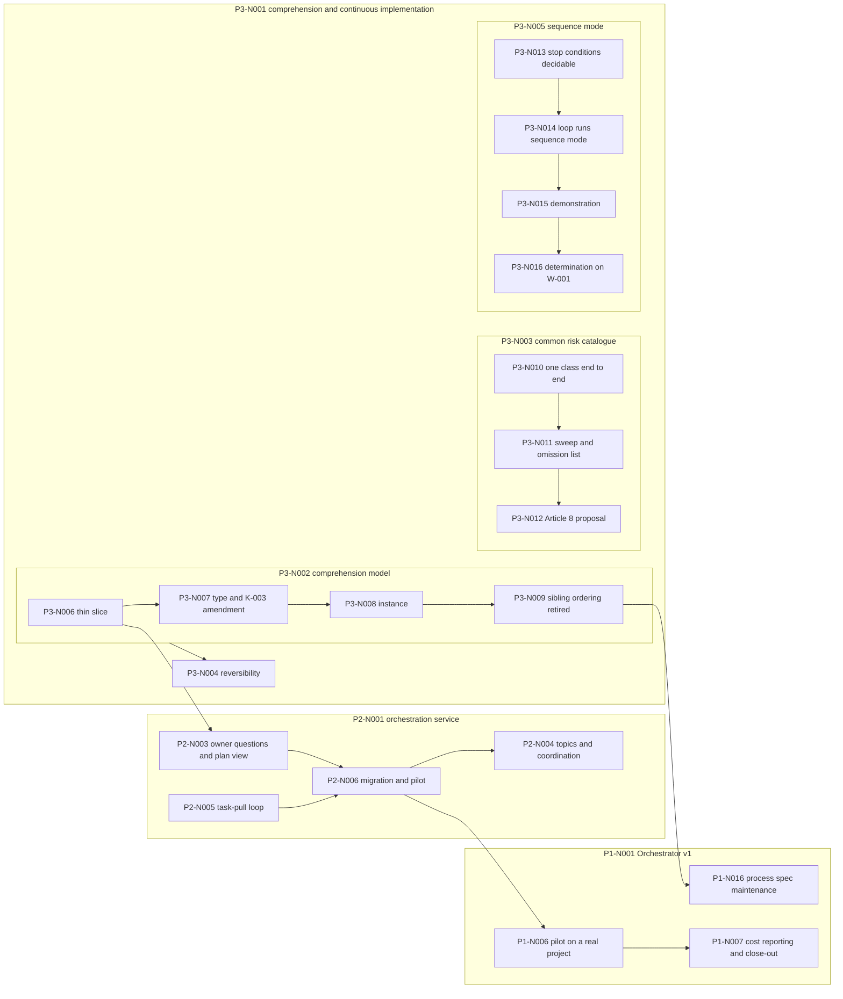

# The project plan, from the Plan register

Reader: the [human owner](https://github.com/majodali/methodology/blob/v1.6.0/docs/vocabulary.md#def-human-owner) returning after weeks away (RD-2 in the methodology's [reader catalog](https://github.com/majodali/methodology/blob/v1.6.0/docs/style.md#readers)), and a fresh agent session (RD-4).
Neither reader has the conversation history.
Both know the methodology at this project's pinned version, 1.6.0 ([Classification](classification.md)), and can follow links.

Status: active

<!-- K-007 contract: Status transitions draft → active → (superseded by
     X, because Y | closed → Backlog entry). Anything unmarked here is a
     live claim of current intent. This is the central plan document, a
     hand rendering of the Plan register. It goes `superseded` when node
     P3-N002 renders the same content mechanically. -->

This [document](https://github.com/majodali/methodology/blob/v1.6.0/docs/vocabulary.md#def-document) renders the [Plan register](plan-register.md) by hand. The rendering adds each node's outcome from the node's [plan](https://github.com/majodali/methodology/blob/v1.6.0/docs/vocabulary.md#def-plan) and [specification](https://github.com/majodali/methodology/blob/v1.6.0/docs/vocabulary.md#def-specification).
The rendering reads the register as it stood on 2026-10-29, after [pull request 14](https://github.com/majodali/project-orchestrator/pull/14) merged.
The register is the single source of the node tree and the stages.
RU-021 (the [planning/execution model](https://github.com/majodali/methodology/blob/main/docs/vocabulary.md#def-planning-execution-model) is the source of progress truth) in the [Ruling register](rulings.md) sets that authority.
Where this document and the register disagree, the register wins.
The Orchestrator updates this document in the commit that changes the register, under the methodology's [W-003 (documentation moves in the same commit as the work)](https://github.com/majodali/methodology/blob/v1.6.0/docs/rules/working-agreement.md#w-003--documentation-moves-in-the-same-commit-as-the-work).
That duty lasts until node P3-N002 (the comprehension model) renders the document mechanically.

## What the project builds: three lines of work

The project builds orchestration for the majodali portfolio in three lines of work.
Each line is a top-level [node](process/README.md#def-node) of the [Plan register](plan-register.md).

- P1-N001 (Orchestrator v1) delivers a process [specification](https://github.com/majodali/methodology/blob/v1.6.0/docs/vocabulary.md#def-specification) and a Claude Code plugin that run role-based agent sessions through the methodology at low cost.
- P2-N001 (Orchestration service) delivers a service that sessions call over MCP. The service holds shared plan state, coordination, owner questions and a view of the [plan](https://github.com/majodali/methodology/blob/v1.6.0/docs/vocabulary.md#def-plan), while git stays authoritative.
- P3-N001 (Project comprehension and continuous implementation) delivers a model of what each part of a project is and what depends on it. The line adds three mitigations that make longer autonomous work safe.

The methodology's [vision](https://github.com/majodali/methodology/blob/main/docs/vision.md) states the portfolio direction these lines serve.
The methodology's draft [roadmap IR](https://github.com/majodali/methodology/blob/main/docs/roadmap.ir.md) orders the next steps against this project's nodes.

## How to read this document: stages, dependencies and gates

Every node of the [plan](https://github.com/majodali/methodology/blob/v1.6.0/docs/vocabulary.md#def-plan) carries one [stage](process/plan-model.md#the-node-lifecycle) from the node lifecycle.

- identified: the node exists in the [Plan register](plan-register.md), created by its parent's breakdown or at enrollment.
- planned: the node's [plan](https://github.com/majodali/methodology/blob/v1.6.0/docs/vocabulary.md#def-plan) records its outcome, approach, dependencies, and whether it is a leaf or interior node.
- specified: the node's [specification](https://github.com/majodali/methodology/blob/v1.6.0/docs/vocabulary.md#def-specification) records its behavior and verification criteria.
- broken-down: an interior node's children are defined and entered in the register as identified.
- executing: a leaf node's work is being done.
- verifying: the node is being checked against its own criteria.
- done: the node is verified and accepted, and its Backlog [entry](https://github.com/majodali/methodology/blob/v1.6.0/docs/vocabulary.md#def-entry) is rewritten to say what shipped.

Each node below carries five fields, always in this order.

- Stage: the current stage, with the date it was reached where a record states one.
- Outcome: for a done node, what shipped. For an open node, what done looks like, from its plan or its parent's specification.
- Depends on: the nodes that must finish before this node's next stage can start.
- Needed by: the nodes that wait on this one.
- Documents: links to the node's plan and specification, where they exist.

The dependencies come from the register's annotations and from the child order in each parent's specification.
RU-018 (a child is not queued behind a sibling it does not depend on) means a node waits only on a recorded dependency.
Where nothing is recorded, the default in [dispatch.md](process/dispatch.md) holds a node's execute stage behind its earlier siblings.
A gated node carries a `[gated: ...]` [hold marker](process/plan-register.md#location-and-shape) and moves only when the [human owner](https://github.com/majodali/methodology/blob/v1.6.0/docs/vocabulary.md#def-human-owner) rules at that gate.
An interior node finishes only after all its children are done.

## P1-N001 Orchestrator v1, the process specification and the plugin

- Stage: broken-down since enrollment, 2026-08-25.
- Outcome: A runtime-agnostic process [specification](https://github.com/majodali/methodology/blob/v1.6.0/docs/vocabulary.md#def-specification) and the Claude Code plugin that implements it, exercised on one real portfolio project. Role-based agent sessions then do methodology-compliant work at minimum model and context cost.
- Depends on: its open children P1-N016, P1-N006 and P1-N007.
- Needed by: nothing.
- Documents: [plan](plans/orchestrator-v1.md).

### P1-N002 Bootstrap and founding plan (chunk 1)

- Stage: done before the [Plan register](plan-register.md) existed. No record states the date.
- Outcome: Shipped the repository's methodology scaffolding and the founding [plan](https://github.com/majodali/methodology/blob/v1.6.0/docs/vocabulary.md#def-plan).
- Depends on: nothing.
- Needed by: P1-N003.
- Documents: [plan, chunk 1](plans/orchestrator-v1.md#chunk-1--bootstrap-and-founding-plan).

### P1-N003 Process specification v1 (chunk 2)

- Stage: done, 2026-08-24, when the owner approved the review revisions.
- Outcome: Shipped [docs/process/](process/), holding the node lifecycle, the Plan register format, the dispatch loop, the profiles by [C-tier](https://github.com/majodali/methodology/blob/v1.6.0/docs/vocabulary.md#def-c-tier) and the Cost log convention.
- Depends on: P1-N002.
- Needed by: P1-N004.
- Documents: [plan, chunk 2](plans/orchestrator-v1.md#chunk-2--process-specification-v1).

### P1-N004 Role definitions v1 (chunk 3)

- Stage: done before the register existed. No record states the date.
- Outcome: Shipped the roles as contracts in [roles.md](process/roles.md), with the model-tier mapping and the Auditor's `mtool` compliance contract.
- Depends on: P1-N003.
- Needed by: P1-N005.
- Documents: [plan, chunk 3](plans/orchestrator-v1.md#chunk-3--role-definitions-v1).

### P1-N005 Plugin v1 with self-hosted trial (chunk 4)

- Stage: done, 2026-08-26, at the owner's demonstration gate.
- Outcome: Shipped the `orchestrator` plugin with the role agents, process skills, form checker, journal tail and billing check. Four trials ran the plugin on this repository.
- Depends on: P1-N004.
- Needed by: P1-N006 under the founding plan, whose pilot P2-N006 now carries.
- Documents: [plan, chunk 4](plans/orchestrator-v1.md#chunk-4--plugin-v1).

### P1-N008 mtool checker extension-point proposal

- Stage: done, 2026-08-26.
- Outcome: Shipped a decision-ready proposal to methodology-tools. A [custom document type](https://github.com/majodali/methodology/blob/v1.6.0/docs/vocabulary.md#def-custom-document-type) defined by citation may declare a checker, which `mtool audit form` discovers and runs.
- Depends on: nothing.
- Needed by: nothing open. Delivery upstream is a Backlog item.
- Documents: [plan](plans/p1-n008-mtool-checker-extension-point.md), [specification](specs/p1-n008-mtool-checker-extension-point.md).

### P1-N009 Plugin tooling on the portfolio stack

- Stage: done, 2026-08-31.
- Outcome: Shipped the plugin's three scripts in TypeScript on Node. The Plan register grammar has one implementation, shared with the service under a drift check.
- Depends on: nothing.
- Needed by: nothing open. P2-N010 (plan-state update) consumes the shared grammar.
- Documents: [plan](plans/p1-n009-plugin-tooling-portfolio-stack.md), [specification](specs/p1-n009-plugin-tooling-portfolio-stack.md).

The children of P1-N009, in their chain order:

- P1-N010 Node toolchain and the shared register grammar, proven by journal_tail
  - Stage: done, 2026-08-30.
  - Outcome: Shipped the Node toolchain and the shared grammar unit, proven by porting `journal_tail`.
  - Depends on: nothing.
  - Needed by: P1-N011.
  - Documents: the parent's plan and specification.
- P1-N011 The travelling package: conformance corpus, recorded expectations, vendoring generator
  - Stage: done, 2026-08-30.
  - Outcome: Shipped the conformance fixtures, their recorded expectations, and the generator that copies the unit into other repositories.
  - Depends on: P1-N010.
  - Needed by: P1-N012.
  - Documents: the parent's plan and specification.
- P1-N012 The form checker on the shared unit, proven finding-for-finding
  - Stage: done, 2026-08-30.
  - Outcome: Shipped the form checker in TypeScript, proven to report every finding the Python version reported.
  - Depends on: P1-N011.
  - Needed by: P1-N013.
  - Documents: the parent's plan and specification.
- P1-N013 The cutover: sync_agents ported, every invocation site moved, the Python retired
  - Stage: done, 2026-08-30.
  - Outcome: Shipped `sync_agents` in TypeScript, every call site moved, and the Python scripts removed in one commit.
  - Depends on: P1-N012.
  - Needed by: nothing.
  - Documents: the parent's plan and specification.

### P1-N014 Role contracts adopt the methodology's conduct rules

- Stage: done, 2026-10-29.
- Outcome: Shipped seventeen conduct duties stated once in `docs/process/` and carried by the six role contracts, with `plugin/agents/` regenerated.
- Depends on: nothing.
- Needed by: P3-N014 (the loop runs sequence mode), which waited on this node's execute stage.
- Documents: [plan](plans/p1-n014-role-contracts-adopt-v140-rules.md), [specification](specs/p1-n014-role-contracts-adopt-conduct-rules.md).

### P1-N015 Methodology amendments for delegated, multi-agent work

- Stage: done, 2026-09-01.
- Outcome: Shipped four amendment proposals for the owner to carry upstream. The methodology accepted all four and released them in v1.5.0.
- Depends on: nothing.
- Needed by: nothing open.
- Documents: [plan](plans/p1-n015-methodology-amendments-delegated-work.md), [specification](specs/p1-n015-methodology-amendments-delegated-work.md).

### P1-N016 Process spec maintenance: branch lifecycle, PR citation, packet table

- Stage: identified, 2026-09-01. No plan yet.
- Outcome: Three corrections to `docs/process/`. The first says who deletes a merged branch, and when. The second states how work reaches `main` by pull request. The third fixes the context packets of the plan and break-down stages.
- Depends on: nothing in the register. The Backlog records that its pass rebases on the selection-rule amendment of P3-N009 (sibling ordering retired).
- Needed by: P1-N001.
- Documents: none yet. The node's Backlog [entry](https://github.com/majodali/methodology/blob/v1.6.0/docs/vocabulary.md#def-entry) holds the detail.

### P1-N006 Pilot on a real project (chunk 5)

- Stage: identified at enrollment, 2026-08-25. No plan yet.
- Outcome: Superseded in place by P2-N006 (migration and pilot), where the pilot now runs through the service. The node stays in the register until the founding plan closes out.
- Depends on: P2-N006, which carries its content.
- Needed by: P1-N007.
- Documents: [plan, chunk 5](plans/orchestrator-v1.md#chunk-5--pilot-on-a-real-project).

### P1-N007 Cost reporting v1 and close-out (chunk 6)

- Stage: identified at enrollment, 2026-08-25. No plan yet.
- Outcome: Reporting over the cost logs and run journals per node, role and tier, including service-held state. A retrospective against the founding plan's two goals, then the founding plan closed.
- Depends on: P1-N006, by the sibling-order default.
- Needed by: P1-N001.
- Documents: [plan, chunk 6](plans/orchestrator-v1.md#chunk-6--cost-reporting-v1-and-close-out).

## P2-N001 Orchestration service

- Stage: broken-down, 2026-08-26.
- Outcome: A service that Claude Code sessions in any environment call over MCP. The service holds live project state, coordinates sessions, queues owner questions and publishes a view of the [plan](https://github.com/majodali/methodology/blob/v1.6.0/docs/vocabulary.md#def-plan), while git stays authoritative.
- Depends on: its open children P2-N003, P2-N004, P2-N005 and P2-N006.
- Needed by: nothing.
- Documents: [plan](plans/orchestration-service.md).

### P2-N002 Service skeleton and plan state (chunk 1)

- Stage: done, 2026-09-16.
- Outcome: Shipped a deployed MCP service that reads and updates this project's plan state. Sessions enlist from a checked-in `.mcp.json`, and a git-only fallback is proven.
- Depends on: nothing.
- Needed by: P2-N005 (the task-pull loop), which the roadmap opened when this chunk closed.
- Documents: [plan](plans/p2-n002-service-skeleton.md), [specification](specs/p2-n002-service-skeleton.md).

The children of P2-N002, in their [specification](specs/p2-n002-service-skeleton.md#the-breakdown)'s order:

- P2-N007 Service repository bootstrap
  - Stage: done, 2026-08-27.
  - Outcome: Shipped the service repository, enrolled as a methodology project, with a TypeScript skeleton that builds, tests and lints clean.
  - Depends on: nothing.
  - Needed by: P2-N008 and P2-N009.
  - Documents: the parent's plan and specification.
- P2-N008 Reachability slice: a deployed MCP server a session can call
  - Stage: done, 2026-08-28.
  - Outcome: Shipped a deployed MCP server with one identity tool and bearer-token authentication, reached from a local and a web session.
  - Depends on: P2-N007.
  - Needed by: P2-N011.
  - Documents: the parent's plan and specification.
- P2-N009 Plan-state read
  - Stage: done, 2026-08-30.
  - Outcome: Shipped `plan_read`, which parses the [Plan register](plan-register.md) into structured nodes and names the source commit in every answer.
  - Depends on: P2-N007.
  - Needed by: P2-N010.
  - Documents: the parent's plan and specification.
- P2-N010 Plan-state update, git-authoritative, with the advisory lease
  - Stage: done, 2026-09-01.
  - Outcome: Shipped a leased write that returns an exact register edit and then confirms the edit against the commit.
  - Depends on: P2-N009.
  - Needed by: P2-N011.
  - Documents: the parent's plan and specification.
- P2-N011 Degrade to git-only, and enlistment documentation
  - Stage: done, 2026-09-07.
  - Outcome: Shipped evidence that a session with an unreachable service starts normally and finishes its work through git. Shipped the enlistment guide, [enlistment.md](process/enlistment.md).
  - Depends on: P2-N008 and P2-N010.
  - Needed by: nothing.
  - Documents: the parent's plan and specification.

### P2-N012 Deploy the service from CI on merge

- Stage: done, 2026-09-07.
- Outcome: Shipped checks on every pull request in the service repository. A merge to `main` now deploys, smoke-tests a preprod alias, and only then promotes the version to `live`.
- Depends on: nothing. The owner ruled at its gate that P2-N011 was not a dependency.
- Needed by: nothing open.
- Documents: [plan](plans/p2-n012-deploy-from-ci-on-merge.md), [specification](specs/p2-n012-deploy-from-ci-on-merge.md).

The children of P2-N012, in their [specification](specs/p2-n012-deploy-from-ci-on-merge.md#the-breakdown)'s order:

- P2-N013 Alias assumptions verified against AWS documentation
  - Stage: done, 2026-09-01.
  - Outcome: Shipped a committed finding that answers six platform assumptions, each against dated AWS documentation.
  - Depends on: nothing.
  - Needed by: P2-N015.
  - Documents: the parent's plan and specification.
- P2-N014 Pull-request checks that cannot deploy
  - Stage: done, 2026-09-01.
  - Outcome: Shipped a GitHub Actions job on each pull request that runs build, lint, test and template validation, with no access to deploy credentials.
  - Depends on: nothing.
  - Needed by: nothing.
  - Documents: the parent's plan and specification.
- P2-N015 Alias-aware lease-table selection, failing closed
  - Stage: done, 2026-09-01.
  - Outcome: Shipped lease-table selection by the invoked alias, refusing any alias the service does not recognise.
  - Depends on: P2-N013.
  - Needed by: P2-N016.
  - Documents: the parent's plan and specification.
- P2-N016 Deploy, smoke and promote on merge to main
  - Stage: done, 2026-09-07.
  - Outcome: Shipped the GitHub Actions job on merge that deploys, smoke-tests and promotes, with rollback procedures in the service's [runbook](https://github.com/majodali/methodology/blob/v1.6.0/docs/vocabulary.md#def-runbook).
  - Depends on: P2-N015.
  - Needed by: nothing.
  - Documents: the parent's plan and specification.

### P2-N003 Owner questions and the plan view (chunk 2)

- Stage: identified, 2026-08-26. No plan yet.
- Outcome: The service plan gives this chunk an owner question queue and a first view of the plan hierarchy. On 2026-10-29 the owner split the chunk into the [web view](https://github.com/majodali/methodology/blob/main/docs/vocabulary.md#def-web-view)'s first version and the question queue. The first version is read-only, reads from commits only, and drills to node and task. The register records the split as a note on the node's line.
- Depends on: P3-N006 (the thin end-to-end slice), against which the web view's first version is specified. The question queue comes after the pilot.
- Needed by: P2-N006, which needs the web view's first version.
- Documents: [service plan, chunk 2](plans/orchestration-service.md#chunk-2--owner-questions-and-the-plan-view).

### P2-N004 Topics and coordination (chunk 3)

- Stage: identified, 2026-08-26. No plan yet.
- Outcome: Project topics carry status and coordination between enlisted sessions, including which session is blocked on what.
- Depends on: P2-N006. The owner placed topics after the pilot on 2026-10-29, to be built only on a shown need, and the register records the order.
- Needed by: nothing.
- Documents: [service plan, chunk 3](plans/orchestration-service.md#chunk-3--topics-and-coordination).

### P2-N005 The task-pull loop (chunk 4)

- Stage: identified, 2026-08-26. No plan yet.
- Outcome: A session asks the service for the next task in its role, claims the task, reports progress and reports completion. The loop carries per-task claims, role-aware identity, a branch-name fallback claim, and the freeing of claims a dead session held.
- Depends on: nothing. The owner made the loop the next service step on 2026-10-29, and the register marks the node independent of P2-N003 and P2-N004 under RU-018.
- Needed by: P2-N006.
- Documents: [service plan, chunk 4](plans/orchestration-service.md#chunk-4--the-task-pull-loop).

### P2-N006 Migration and pilot (chunk 5)

- Stage: identified, 2026-08-26. No plan yet.
- Outcome: This repository's own orchestration moves onto the service. The pilot then runs through the service on methodology-tools, which the owner named the first adopter on 2026-10-29. Costs and lessons are recorded.
- Depends on: P2-N005, the web view's first version in P2-N003, and P1-N014, which is done.
- Needed by: P1-N006, P2-N004, and the question queue in P2-N003.
- Documents: [service plan, chunk 5](plans/orchestration-service.md#chunk-5--migration-and-pilot).

## P3-N001 Project comprehension and continuous implementation

- Stage: broken-down, 2026-09-17.
- Outcome: One comprehension model, defined here and instantiated in each managed project, extending the [planning/execution model](https://github.com/majodali/methodology/blob/main/docs/vocabulary.md#def-planning-execution-model). Dependencies are recorded, never inferred. Three mitigations make longer autonomous work safe: a common risk catalogue, measurable reversibility, and a determination on sequence mode.
- Depends on: its open children P3-N002, P3-N003, P3-N004 and P3-N005.
- Needed by: nothing.
- Documents: [plan](plans/comprehension-and-continuous-implementation.md), [specification](specs/p3-n001-comprehension-and-continuous-implementation.md).

### P3-N002 The comprehension model (chunk 1)

- Stage: broken-down, 2026-10-29.
- Outcome: A new [custom document type](https://github.com/majodali/methodology/blob/v1.6.0/docs/vocabulary.md#def-custom-document-type), the Project model, and one instance over this repository built from existing documents. For any part a reader names, the instance says what the part is, its state, its [specification](https://github.com/majodali/methodology/blob/v1.6.0/docs/vocabulary.md#def-specification), its risks, and its dependencies both ways. A reader reaches each answer within a written navigation bound, using git and a text editor.
- Depends on: nothing.
- Needed by: P3-N004.
- Documents: [plan](plans/p3-n002-comprehension-model.md), [specification](specs/p3-n002-comprehension-model.md).

The children of P3-N002, a strict chain in their [specification](specs/p3-n002-comprehension-model.md#the-breakdown)'s order:

- P3-N006 The thin end-to-end slice: five real parts all the way through, and both renderings
  - Stage: planned, 2026-10-29. Gated on the owner's review of its [plan](https://github.com/majodali/methodology/blob/v1.6.0/docs/vocabulary.md#def-plan).
  - Outcome: `docs/project-model.md` carries five real parts through every facet, the navigation bound and both renderings. A slice record states what the slice changed in the sketch notation.
  - Depends on: nothing.
  - Needed by: P3-N007, and the [web view](https://github.com/majodali/methodology/blob/main/docs/vocabulary.md#def-web-view)'s first version in P2-N003.
  - Documents: [plan](plans/p3-n006-thin-end-to-end-slice.md).
- P3-N007 The type declared, the arguments written, the K-003 (the Backlog is the single source of progress truth) amendment drafted
  - Stage: identified, 2026-10-29. No plan yet.
  - Outcome: The Project model's definition in `docs/process/`, its declaration in the [Classification](classification.md), and a journal event kind for recorded edges. A drafted [amendment](https://github.com/majodali/methodology/blob/v1.6.0/docs/vocabulary.md#def-amendment) to the methodology's K-003 (the Backlog is the single source of progress truth), written IR first. Under the amendment, a project that declares a planning/execution model takes that model as its progress truth.
  - Depends on: P3-N006.
  - Needed by: P3-N008.
  - Documents: the parent's specification, child B.
- P3-N008 The instance, over this repository
  - Stage: identified, 2026-10-29. No plan yet.
  - Outcome: The instance covers every current part of this project, and both renderings are compared with the Backlog.
  - Depends on: P3-N007.
  - Needed by: P3-N009.
  - Documents: the parent's specification, child C.
- P3-N009 Sibling ordering retired, and the checks that replace it
  - Stage: identified, 2026-10-29. No plan yet.
  - Outcome: The four statements that give sibling order a dependency meaning are amended. The selection rule in [dispatch.md](process/dispatch.md) reads recorded edges, and the form checker gains the model's rules.
  - Depends on: P3-N008.
  - Needed by: P1-N016, whose pass rebases on the amended selection rule.
  - Documents: the parent's specification, child D.

### P3-N003 The common risk catalogue (chunk 2)

- Stage: broken-down, 2026-10-29.
- Outcome: A populated catalogue of risk classes every managed project must mitigate, drafted here and proposed to the methodology. Each [entry](https://github.com/majodali/methodology/blob/v1.6.0/docs/vocabulary.md#def-entry) names the real encounter it came from, with a date. A check applies the catalogue to this project and lists genuine omissions for the owner.
- Depends on: nothing. The [Plan register](plan-register.md) marks the node independent of P3-N002 under RU-018.
- Needed by: nothing.
- Documents: [plan](plans/p3-n003-common-risk-catalogue.md), [specification](specs/p3-n003-common-risk-catalogue.md).

The children of P3-N003, a strict chain in their [specification](specs/p3-n003-common-risk-catalogue.md#the-breakdown)'s order:

- P3-N010 One class, carried end to end
  - Stage: planned, 2026-10-29. Gated on the owner's review of its [plan](https://github.com/majodali/methodology/blob/v1.6.0/docs/vocabulary.md#def-plan).
  - Outcome: The catalogue holds one class, CR-001 (a check that cannot fail in the environment the code runs in). The class-to-instance check runs for that class, and a deliberate negative control breaks the check.
  - Depends on: nothing.
  - Needed by: P3-N011.
  - Documents: [plan](plans/p3-n010-one-class-end-to-end.md).
- P3-N011 The sweep, the rest of the catalogue, and the omission list
  - Stage: identified, 2026-10-29. No plan yet.
  - Outcome: Every candidate in the five swept sources is dispositioned on the record. The catalogue holds every admitted class, Risk register entries cite their classes, and the omission list exists.
  - Depends on: P3-N010.
  - Needed by: P3-N012.
  - Documents: the parent's specification, child B.
- P3-N012 The Article 8 proposal, written IR first and reviewed
  - Stage: identified, 2026-10-29. No plan yet.
  - Outcome: The catalogue and a cover note form an amendment proposal under the methodology's Article 8 (amendments, versions, and migration). Both are written IR first and judged readable by a [stranger](https://github.com/majodali/methodology/blob/v1.6.0/docs/vocabulary.md#def-stranger). The node carries nothing upstream.
  - Depends on: P3-N011.
  - Needed by: nothing.
  - Documents: the parent's specification, child C.

### P3-N004 Reversibility, and the measurement that says whether it pays (chunk 3)

- Stage: identified, 2026-09-17. No plan yet.
- Outcome: Work inside an active workstream is cheap to reverse and redo, and a measurement says whether that trade pays. The Cost log gains a field naming what a rework row reworks. One real comparison over this project's history is recorded. An unfavourable result satisfies the criterion, under RU-019 (a measurement criterion may be met by an unfavourable result).
- Depends on: P3-N002.
- Needed by: nothing.
- Documents: none yet. The parent's [specification](specs/p3-n001-comprehension-and-continuous-implementation.md#the-breakdown), chunk 3, holds the detail.

### P3-N005 Sequence mode (chunk 4)

- Stage: broken-down, 2026-10-29.
- Outcome: This project's dispatch loop runs the pre-ratified sequence mode of the methodology's W-001 (two delivery modes, human-gated). The four stop conditions become predicates the roles apply without fresh judgment. A determination on whether W-001 (two delivery modes, human-gated) needs specialising upstream is recorded either way.
- Depends on: nothing. The register marks the node independent of P3-N002 under RU-018.
- Needed by: nothing.
- Documents: [plan](plans/p3-n005-sequence-mode.md), [specification](specs/p3-n005-sequence-mode.md).

The children of P3-N005, a strict chain in their [specification](specs/p3-n005-sequence-mode.md#the-breakdown)'s order:

- P3-N013 The four stop conditions, decidable, evidenced, and related to the [meta-review signals](https://github.com/majodali/methodology/blob/v1.6.0/docs/vocabulary.md#def-meta-review-signal)
  - Stage: planned, 2026-10-29. Gated on the owner's review of its [plan](https://github.com/majodali/methodology/blob/v1.6.0/docs/vocabulary.md#def-plan).
  - Outcome: The four stop conditions exist as committed predicates, and two blind readings apply them identically to this project's past task results. A table relates the conditions to the methodology's four meta-review signals.
  - Depends on: nothing.
  - Needed by: P3-N014.
  - Documents: [plan](plans/p3-n013-stop-conditions-decidable.md).
- P3-N014 The loop runs sequence mode, and the roles meet the conditions without looking
  - Stage: identified, 2026-10-29. No plan yet.
  - Outcome: [dispatch.md](process/dispatch.md) carries a sequence-mode section, and each role contract carries the conditions that role can trigger. The run journal can record a ratification and a stop.
  - Depends on: P3-N013, and the execute stage of P1-N014, which is done.
  - Needed by: P3-N015.
  - Documents: the parent's specification, child B.
- P3-N015 The demonstration: a ratified sequence lands two chunks and stops on asks
  - Stage: identified, 2026-10-29. No plan yet.
  - Outcome: An owner-ratified sequence lands at least two chunks with no gate between them, then stops on a result that carries asks.
  - Depends on: P3-N014.
  - Needed by: P3-N016.
  - Documents: the parent's specification, child C.
- P3-N016 The determination on W-001 (two delivery modes, human-gated), and the artifact or the argument
  - Stage: identified, 2026-10-29. No plan yet.
  - Outcome: The determination is recorded, as an amendment proposal or as an argument that the released sequence mode needs no change.
  - Depends on: P3-N015.
  - Needed by: nothing.
  - Documents: the parent's specification, child D.

## How the lines depend on each other

Five dependencies cross between the lines of the [plan](https://github.com/majodali/methodology/blob/v1.6.0/docs/vocabulary.md#def-plan).
The owner set three of them on 2026-10-29, recorded on the register's lines and in the methodology's draft [roadmap IR](https://github.com/majodali/methodology/blob/main/docs/roadmap.ir.md).

- P3-N014 (the loop runs sequence mode) waits on the execute stage of P1-N014 (role contracts adopt the conduct rules), which is done.
- The [web view](https://github.com/majodali/methodology/blob/main/docs/vocabulary.md#def-web-view)'s first version, in P2-N003 (owner questions and the plan view), is specified against the slice of P3-N006 (the thin end-to-end slice).
- The pilot in P2-N006 (migration and pilot) follows P2-N005 (the task-pull loop) and the web view's first version.
- P1-N006 (pilot on a real project) is superseded in place by P2-N006, and P1-N007 (cost reporting and close-out) follows P1-N006.
- P1-N016 (process spec maintenance) rebases its pass on the selection-rule amendment of P3-N009 (sibling ordering retired).

Inside line P3, P3-N004 (reversibility) depends on P3-N002 (the comprehension model).

The diagram shows every node that is not done.
An arrow runs from a node to the node that waits on it.
A box drawn around nodes is their parent, which finishes after all of them.

## What is next: actionable, gated, waiting, and unplanned nodes

A node is actionable when its recorded dependencies are met.
Dispatch still needs the owner to grant the node's approved scope ([dispatch.md](process/dispatch.md)).

Actionable now:

- P2-N005 (the task-pull loop): the [plan](https://github.com/majodali/methodology/blob/v1.6.0/docs/vocabulary.md#def-plan) stage, the next service step the owner chose on 2026-10-29.
- P1-N016 (process spec maintenance): the plan stage, which has no recorded dependency.

Gated on the owner:

- P3-N006 (the thin end-to-end slice): the owner's review of its plan.
- P3-N010 (one class, carried end to end): the owner's review of its plan.
- P3-N013 (the four stop conditions, decidable): the owner's review of its plan.

Waiting:

- P3-N007 (the Project model definition and the amendment): waits on P3-N006.
- P3-N008 (the instance): waits on P3-N007.
- P3-N009 (sibling ordering retired): waits on P3-N008.
- P3-N011 (the sweep): waits on P3-N010.
- P3-N012 (the Article 8 proposal): waits on P3-N011.
- P3-N014 (the loop runs sequence mode): waits on P3-N013.
- P3-N015 (the demonstration): waits on P3-N014.
- P3-N016 (the determination): waits on P3-N015.
- P3-N004 (reversibility): waits on P3-N002.
- P2-N003 (owner questions and the plan view): the [web view](https://github.com/majodali/methodology/blob/main/docs/vocabulary.md#def-web-view) waits on P3-N006, and the question queue waits on the pilot.
- P2-N006 (migration and pilot): waits on P2-N005 and the web view's first version.
- P2-N004 (topics and coordination): waits on the pilot in P2-N006.
- P1-N006 (pilot on a real project): waits on P2-N006.
- P1-N007 (cost reporting and close-out): waits on P1-N006.
- P3-N002, P3-N003 and P3-N005: each waits on its children.
- P1-N001, P2-N001 and P3-N001: each waits on its open children.

No plan yet:

- P1-N016 (process spec maintenance)
- P1-N006 (pilot on a real project)
- P1-N007 (cost reporting and close-out)
- P2-N003 (owner questions and the plan view)
- P2-N004 (topics and coordination)
- P2-N005 (the task-pull loop)
- P2-N006 (migration and pilot)
- P3-N004 (reversibility)
- P3-N007 (the Project model definition and the amendment)
- P3-N008 (the instance)
- P3-N009 (sibling ordering retired)
- P3-N011 (the sweep)
- P3-N012 (the Article 8 proposal)
- P3-N014 (the loop runs sequence mode)
- P3-N015 (the demonstration)
- P3-N016 (the determination)

## Where the detail is: the documents this plan summarizes

- [Plan register](plan-register.md): the node tree and the stages, and the authority on both.
- [Process specification](process/): the node lifecycle, dispatch, the roles and the register formats.
- [Plans](plans/): one plan per planned node, with the outcome, approach and gate decisions.
- [Specifications](specs/): the verification criteria and the breakdown of each specified node.
- [Backlog](backlog.md): what each done node shipped, and the open items that are not nodes.
- [Ruling register](rulings.md): the owner's recurring decisions. RU-016 (the Planner declares the repository access a node needs) sets each plan's repository reach. RU-020 (a breakdown at specification depth needs no separate task) is why the P3 children entered at their parents' gates. RU-022 (a text drafted for the methodology is written IR first) governs P3-N007 and P3-N012.
- [Risk register](open-risks.md): the open and closed risks the nodes mitigate.
