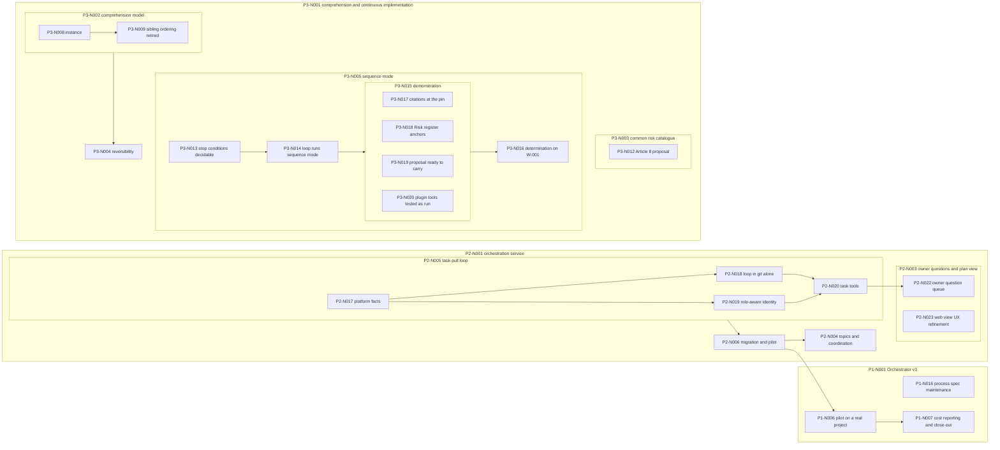

# The project plan, from the Plan register

Reader: the [human owner](https://github.com/majodali/methodology/blob/v1.6.0/docs/vocabulary.md#def-human-owner) returning after weeks away (RD-2 in the methodology's [reader catalog](https://github.com/majodali/methodology/blob/v1.6.0/docs/style.md#readers)), and a fresh agent session (RD-4).
Neither reader has the conversation history.
Both know the methodology at this project's pinned version, 1.6.0 ([Classification](classification.md)), and can follow links.

Status: active

<!-- K-007 contract: Status transitions draft → active → (superseded by
     X, because Y | closed → Backlog entry). Anything unmarked here is a
     live claim of current intent. This is the central plan document, a
     hand rendering of the Plan register. It goes `superseded` when the
     renderings of nodes P3-N006 and P3-N008 replace it. -->

This [document](https://github.com/majodali/methodology/blob/v1.6.0/docs/vocabulary.md#def-document) renders the [Plan register](plan-register.md) by hand.
Each node's outcome comes from the node's [plan](https://github.com/majodali/methodology/blob/v1.6.0/docs/vocabulary.md#def-plan) and [specification](https://github.com/majodali/methodology/blob/v1.6.0/docs/vocabulary.md#def-specification).
The rendering reads the register as it stands after the owner's gates of 2026-10-30, including the specification gates of P2-N003 and P2-N005 and the verifying gate of P3-N007, and after the owner's verifying gate of P2-N021 and adoption of P2-N023 on 2026-11-03.
It also reads the owner's decision of 2026-11-03 on P2-N022 and P2-N017, the owner's verifying gate of P3-N011 that day, and the owner's plan gate of P1-N016 that day.
It also reads the owner's plan gate of P3-N015 on 2026-11-04, which ratified that node's sequence.
It also reads the owner's rulings of 2026-11-05 at the acceptance of P1-N016's task E2.
It also reads the owner's words of 2026-11-07, which ended P2-N023's loop after three iterations.
Where this document and the register disagree, the register wins.

Today the Plan register holds the node tree and the stages.
Today the [Backlog](backlog.md) holds the implementation map (its checked entries, wherever they sit) and the list of what is next (its open entries).
K-003 (the Backlog is the single source of progress truth) requires that at 1.6.0.
On 2026-10-29 the owner decided that the [planning/execution model](https://github.com/majodali/methodology/blob/main/docs/vocabulary.md#def-planning-execution-model) takes over the implementation map and the list of what is next.
The decision is RU-021 (the planning/execution model is the source of progress truth), in the [Ruling register](rulings.md).
The takeover waits until the methodology releases the amendment to K-003 (the Backlog is the single source of progress truth) that P3-N007 drafted. The owner approved that amendment for carrying on 2026-10-30.
The owner carries that amendment upstream, under RU-002 (the owner hand-carries upstream output).
Before that [release](https://github.com/majodali/methodology/blob/v1.6.0/docs/vocabulary.md#def-release), this document is a rendering of the register with no authority of its own.

The [Orchestrator](process/roles.md#orchestrator) role updates this document in the commit that changes the register.
The duty follows the methodology's [W-003 (documentation moves in the same commit as the work)](https://github.com/majodali/methodology/blob/v1.6.0/docs/rules/working-agreement.md#w-003--documentation-moves-in-the-same-commit-as-the-work).
The duty ends when the renderings of P3-N006 (the thin end-to-end slice) and P3-N008 (the instance) replace this document.

## What the project builds: three lines of work

The repository majodali/project-orchestrator builds orchestration for the majodali portfolio in three lines of work.
Each line is a top-level [node](process/README.md#def-node) of the [Plan register](plan-register.md).

- P1-N001 (Orchestrator v1) delivers a process [specification](https://github.com/majodali/methodology/blob/v1.6.0/docs/vocabulary.md#def-specification) and a Claude Code plugin. The plugin runs role-based agent sessions through the methodology at low cost.
- P2-N001 (Orchestration service) delivers a service that agent sessions call over MCP (the Model Context Protocol, the tool interface Claude sessions use). The service shares plan state, coordination and owner questions between sessions. Git stays the place where the state is stored.
- P3-N001 (Project comprehension and continuous implementation) delivers a model that says what each part of a project is and what depends on it. The line adds three safeguards for longer runs of work without owner review.

The methodology's [vision](https://github.com/majodali/methodology/blob/main/docs/vision.md) states the portfolio direction the three lines serve.
The methodology's draft [roadmap](https://github.com/majodali/methodology/blob/main/docs/roadmap.ir.md) orders the next steps against these nodes.
The roadmap is written as an IR ([intermediate representation](https://github.com/majodali/methodology/blob/v1.6.0/docs/vocabulary.md#def-intermediate-representation), the methodology's claim-by-claim form of a text).

## How to read this document: stages, chunks, dependencies and gates

Every node of the [plan](https://github.com/majodali/methodology/blob/v1.6.0/docs/vocabulary.md#def-plan) carries one [stage](process/plan-model.md#the-node-lifecycle) from the node lifecycle.

- identified: the node exists in the [Plan register](plan-register.md), created by its parent's breakdown or at [enrollment](process/README.md#defined-terms) of the project.
- planned: the node's [plan](https://github.com/majodali/methodology/blob/v1.6.0/docs/vocabulary.md#def-plan) records its outcome, approach and dependencies.
- specified: the node's [specification](https://github.com/majodali/methodology/blob/v1.6.0/docs/vocabulary.md#def-specification) records its behavior and verification criteria.
- broken-down: a parent node's children are defined and entered in the register.
- executing: a leaf node's work is being done.
- verifying: the node is being checked against its own criteria.
- done: the node is verified and accepted. Its [Backlog](backlog.md) [entry](https://github.com/majodali/methodology/blob/v1.6.0/docs/vocabulary.md#def-entry) is rewritten to say what shipped.

A chunk, marked "(chunk 1)" in a node's name, is one step of a line that the owner reviews at its own [chunk gate](https://github.com/majodali/methodology/blob/v1.6.0/docs/vocabulary.md#def-chunk-gate).

Each node below carries five fields, always in this order.

- Stage: the current stage, with the date it was reached where a record states one.
- Outcome: for a done node, what shipped. For an open node, what done looks like.
- Depends on: the nodes, outside this node's own subtree, whose completion this node's work waits on. A parent's own children are never listed here, because a parent finishes when its children do.
- Needed by: the nodes that wait on this one.
- Documents: links to the node's plan and specification, where they exist.

The dependencies come from the register's notes and from the child order in each parent's specification.
RU-018 (a child is not queued behind a sibling it does not depend on) lets a node marked independent run beside its siblings.
For a node not marked independent, the default in [dispatch.md](process/dispatch.md) still applies today.
Under that default, a node starts executing only after the siblings listed before it in the register are done.
A register note that orders two siblings, such as the owner's notes of 2026-10-29 on P2-N004 and P2-N005, overrides the default for those siblings.
P3-N009 (sibling ordering retired) removes the default.
A gated node carries a `[gated: ...]` [hold marker](process/plan-register.md#location-and-shape).
The gated node moves only when the [human owner](https://github.com/majodali/methodology/blob/v1.6.0/docs/vocabulary.md#def-human-owner) rules at the node's gate.
A parent node finishes only after all its children are done.

Three terms of the comprehension model recur under P3-N002.
A facet is one labelled line of a part's [entry](https://github.com/majodali/methodology/blob/v1.6.0/docs/vocabulary.md#def-entry) in the model, such as `state` or `risks`.
An edge is a line saying that a node creates, modifies or uses a part.
The sketch notation is the draft entry format in the [P3-N002 plan](plans/p3-n002-comprehension-model.md#where-the-entries-live-and-what-one-looks-like).

## P1-N001 Orchestrator v1, the process specification and the plugin

- Stage: broken-down since enrollment.
- Outcome: A process [specification](https://github.com/majodali/methodology/blob/v1.6.0/docs/vocabulary.md#def-specification) and a Claude Code plugin that runs it at low cost, tried on one real portfolio project.
- Depends on: nothing beyond its children.
- Needed by: nothing.
- Documents: the [founding plan](plans/orchestrator-v1.md).

### P1-N002 Bootstrap and founding plan (chunk 1)

- Stage: done before the [Plan register](plan-register.md) existed. No record states the date.
- Outcome: Shipped the repository's methodology files and the founding [plan](https://github.com/majodali/methodology/blob/v1.6.0/docs/vocabulary.md#def-plan).
- Depends on: nothing.
- Needed by: P1-N003.
- Documents: [plan, chunk 1](plans/orchestrator-v1.md#chunk-1--bootstrap-and-founding-plan).

### P1-N003 Process specification v1 (chunk 2)

- Stage: done, 2026-08-24, when the owner approved the review revisions.
- Outcome: Shipped [docs/process/](process/), holding the node lifecycle, the register formats, the dispatch loop and the [Cost log](cost-log.md) format.
- Depends on: P1-N002.
- Needed by: P1-N004.
- Documents: [plan, chunk 2](plans/orchestrator-v1.md#chunk-2--process-specification-v1).

### P1-N004 Role definitions v1 (chunk 3)

- Stage: done before the register existed. No record states the date.
- Outcome: Shipped the role contracts in [roles.md](process/roles.md), including the Auditor's duty to run `mtool`, the audit tool of [methodology-tools](https://github.com/majodali/methodology-tools).
- Depends on: P1-N003.
- Needed by: P1-N005.
- Documents: [plan, chunk 3](plans/orchestrator-v1.md#chunk-3--role-definitions-v1).

### P1-N005 Plugin v1 with self-hosted trial (chunk 4)

- Stage: done, 2026-08-26, at the owner's demonstration gate.
- Outcome: Shipped the `orchestrator` plugin: role agents, process skills, a [form checker](process/auditing.md#form-checks--a-tool-never-an-agent), a [run journal](process/observability.md) viewer and a billing check.
- Depends on: P1-N004.
- Needed by: P1-N006, whose pilot now runs inside P2-N006.
- Documents: [plan, chunk 4](plans/orchestrator-v1.md#chunk-4--plugin-v1).

### P1-N008 mtool checker extension-point proposal

- Stage: done, 2026-08-26.
- Outcome: Shipped a proposal to methodology-tools: a format a project defines for its own files may name its own checker, which `mtool audit form` then runs.
- Depends on: nothing.
- Needed by: nothing open.
- Documents: [plan](plans/p1-n008-mtool-checker-extension-point.md), [specification](specs/p1-n008-mtool-checker-extension-point.md).

### P1-N009 Plugin tooling on the portfolio stack

- Stage: done, 2026-08-31.
- Outcome: Shipped the plugin's three scripts in TypeScript on Node. One Plan register parser is shared with the service.
- Depends on: nothing.
- Needed by: nothing open.
- Documents: [plan](plans/p1-n009-plugin-tooling-portfolio-stack.md), [specification](specs/p1-n009-plugin-tooling-portfolio-stack.md).

The children of P1-N009, in their chain order:

- P1-N010 Node toolchain and the shared register grammar, proven by journal_tail
  - Stage: done, 2026-08-30.
  - Outcome: Shipped the Node toolchain and the shared register parser. Their first user was `journal_tail`, the plugin's script that prints the latest run journal events.
  - Depends on: nothing.
  - Needed by: P1-N011.
  - Documents: the parent's plan and specification.
- P1-N011 The travelling package: conformance corpus, recorded expectations, vendoring generator
  - Stage: done, 2026-08-30.
  - Outcome: Shipped test fixtures, their expected results, and a script that copies the shared parser into other repositories.
  - Depends on: P1-N010.
  - Needed by: P1-N012.
  - Documents: the parent's plan and specification.
- P1-N012 The form checker on the shared unit, proven finding-for-finding
  - Stage: done, 2026-08-30.
  - Outcome: Shipped the form checker in TypeScript, reporting exactly the findings the Python version reported.
  - Depends on: P1-N011.
  - Needed by: P1-N013.
  - Documents: the parent's plan and specification.
- P1-N013 The cutover: sync_agents ported, every invocation site moved, the Python retired
  - Stage: done, 2026-08-30.
  - Outcome: Shipped `sync_agents`, the script that copies the role contracts into the plugin, in TypeScript. That commit also removed the Python scripts.
  - Depends on: P1-N012.
  - Needed by: nothing.
  - Documents: the parent's plan and specification.

### P1-N014 Role contracts adopt the methodology's conduct rules

- Stage: done, 2026-10-29.
- Outcome: Shipped seventeen conduct duties, stated once in `docs/process/` and carried by the six role contracts.
- Depends on: nothing.
- Needed by: P3-N014 (the loop runs sequence mode) and P2-N006 (migration and pilot). Both waits are met, because this node is done.
- Documents: [plan](plans/p1-n014-role-contracts-adopt-v140-rules.md), [specification](specs/p1-n014-role-contracts-adopt-conduct-rules.md).

### P1-N015 Methodology amendments for delegated, multi-agent work

- Stage: done, 2026-09-01.
- Outcome: Shipped four amendment proposals, which the methodology accepted and released in v1.5.0.
- Depends on: nothing.
- Needed by: nothing open.
- Documents: [plan](plans/p1-n015-methodology-amendments-delegated-work.md), [specification](specs/p1-n015-methodology-amendments-delegated-work.md).

### P1-N016 Process spec maintenance: branch lifecycle, PR citation, packet table

- Stage: verifying, 2026-11-05, gated on the owner. The owner crossed the plan gate on 2026-11-03, adopting all seventeen decisions at their defaults and ratifying the five names. Under decision 2 the plan's criteria V1 to V15 and decisions 4 to 16 are the specification. Execute task E1 (T103, an Implementer task at the standard tier) ran on branch p1-n016-e1; it wrote `dispatch.md`, `roles.md`, the three role contracts and the orchestrate skill. E1 was accepted on 2026-11-03 under the owner's rulings A23 to A25. E2 (T104) was dispatched on 2026-11-03 and accepted on 2026-11-05 under the owner's rulings A26 to A28. Every criterion is met ([plan](plans/p1-n016-process-spec-maintenance.md), *Verification record*). At the verifying gate the owner verifies that `docs/vocabulary.md` holds the ratified terms and that the journal kinds `unblocked` and `risk-opened` appear in the service's copy.
- Outcome: Every Backlog row routed to this node, thirty-five in all, is landed in the process specification or closed with a stated reason. `dispatch.md` says who deletes a task branch and when, and how work reaches `main` by pull request. The packet table carries every observation recorded against it. `plan-model.md` says what a leaf is when its work takes several tasks. `observability.md` can record a block's release and a new risk. The project gains a vocabulary file. Each process-scope ruling flagged for promotion is promoted or declined.
- Depends on: nothing for planning. Its executing stage waits on the acceptance of E1, the first execute task of P3-N007 (the type declared), which edits the same process documents. That wait is met: P3-N007 is done. P1-N016 does not wait on P3-N009 (sibling ordering retired) ([plan](plans/p1-n016-process-spec-maintenance.md), decision 3).
- Needed by: P1-N001.
- Documents: [plan](plans/p1-n016-process-spec-maintenance.md).

### P1-N006 Pilot on a real project (chunk 5)

- Stage: identified at enrollment. No plan yet.
- Outcome: The pilot this node was created for now runs inside P2-N006 (migration and pilot), through the service. No work remains in P1-N006 itself. The node is not done. It stays identified until P2-N006 is done. P1-N007 then retires it with the founding plan. P1-N006 has no executing stage of its own, so the sibling-order default does not reach it.
- Depends on: P2-N006.
- Needed by: P1-N007.
- Documents: [plan, chunk 5](plans/orchestrator-v1.md#chunk-5--pilot-on-a-real-project).

### P1-N007 Cost reporting v1 and close-out (chunk 6)

- Stage: identified at enrollment. No plan yet.
- Outcome: Reports of cost per node, role and tier, drawn from the Cost log, the run journal and the service. A review against the founding plan's two goals, then the founding plan closed.
- Depends on: P1-N006, by the dispatch.md default, for its executing stage. Its planning can start at any time.
- Needed by: P1-N001.
- Documents: [plan, chunk 6](plans/orchestrator-v1.md#chunk-6--cost-reporting-v1-and-close-out).

## P2-N001 Orchestration service

- Stage: broken-down, 2026-08-26.
- Outcome: A service that agent sessions call over MCP, holding shared [plan](https://github.com/majodali/methodology/blob/v1.6.0/docs/vocabulary.md#def-plan) state, coordination and owner questions, with git as the store.
- Depends on: nothing beyond its children.
- Needed by: nothing.
- Documents: [plan](plans/orchestration-service.md).

### P2-N002 Service skeleton and plan state (chunk 1)

- Stage: done, 2026-09-16.
- Outcome: Shipped a deployed MCP service that reads and updates the project's plan state, while sessions keep working through git when the service is down.
- Depends on: nothing.
- Needed by: P2-N005 (the task-pull loop).
- Documents: [plan](plans/p2-n002-service-skeleton.md), [specification](specs/p2-n002-service-skeleton.md).

The children of P2-N002, in their [specification](specs/p2-n002-service-skeleton.md#the-breakdown)'s order:

- P2-N007 Service repository bootstrap
  - Stage: done, 2026-08-27.
  - Outcome: Shipped the service repository with a TypeScript skeleton that builds, tests and lints clean.
  - Depends on: nothing.
  - Needed by: P2-N008 and P2-N009.
  - Documents: the parent's plan and specification.
- P2-N008 Reachability slice: a deployed MCP server a session can call
  - Stage: done, 2026-08-28.
  - Outcome: Shipped a deployed MCP server with one identity tool and token authentication, reached from local and web sessions.
  - Depends on: P2-N007.
  - Needed by: P2-N011.
  - Documents: the parent's plan and specification.
- P2-N009 Plan-state read
  - Stage: done, 2026-08-30.
  - Outcome: Shipped `plan_read`, which parses the [Plan register](plan-register.md) and names the source commit in every answer.
  - Depends on: P2-N007.
  - Needed by: P2-N010.
  - Documents: the parent's plan and specification.
- P2-N010 Plan-state update, git-authoritative, with the advisory lease
  - Stage: done, 2026-09-01.
  - Outcome: Shipped register updates through the service while one session holds a short-lived write lock.
  - Depends on: P2-N009.
  - Needed by: P2-N011.
  - Documents: the parent's plan and specification.
- P2-N011 Degrade to git-only, and enlistment documentation
  - Stage: done, 2026-09-07.
  - Outcome: Shipped proof that sessions keep working through git when the service is down. Shipped the [guide](process/enlistment.md) to connecting a repository through `.mcp.json`.
  - Depends on: P2-N008 and P2-N010.
  - Needed by: nothing.
  - Documents: the parent's plan and specification.

### P2-N012 Deploy the service from CI on merge

- Stage: done, 2026-09-07.
- Outcome: Shipped automatic deployment: checks on every pull request, and a deploy on merge that goes live only after a smoke test passes.
- Depends on: nothing. The owner ruled at its gate that P2-N011 was not a dependency.
- Needed by: nothing open.
- Documents: [plan](plans/p2-n012-deploy-from-ci-on-merge.md), [specification](specs/p2-n012-deploy-from-ci-on-merge.md).

The children of P2-N012, in their [specification](specs/p2-n012-deploy-from-ci-on-merge.md#the-breakdown)'s order:

- P2-N013 Alias assumptions verified against AWS documentation
  - Stage: done, 2026-09-01.
  - Outcome: Shipped a written check of six deployment assumptions against dated AWS documentation.
  - Depends on: nothing.
  - Needed by: P2-N015.
  - Documents: the parent's plan and specification.
- P2-N014 Pull-request checks that cannot deploy
  - Stage: done, 2026-09-01.
  - Outcome: Shipped pull-request checks for build, lint, tests and template validation, with no access to deploy credentials.
  - Depends on: nothing.
  - Needed by: nothing.
  - Documents: the parent's plan and specification.
- P2-N015 Alias-aware lease-table selection, failing closed
  - Stage: done, 2026-09-01.
  - Outcome: Shipped a separate write-lock table for the test deployment, with any unknown deployment refused.
  - Depends on: P2-N013.
  - Needed by: P2-N016.
  - Documents: the parent's plan and specification.
- P2-N016 Deploy, smoke and promote on merge to main
  - Stage: done, 2026-09-07.
  - Outcome: Shipped the merge job that deploys, smoke-tests and promotes, with rollback steps in the service's [runbook](https://github.com/majodali/methodology/blob/v1.6.0/docs/vocabulary.md#def-runbook).
  - Depends on: P2-N015.
  - Needed by: nothing.
  - Documents: the parent's plan and specification.

### P2-N003 Owner questions and the plan view (chunk 2)

- Stage: broken-down, 2026-10-30, at the owner's specification gate: decisions 11 to 15 adopted, the terms view token, view cookie and not computable ratified, the two children entered (RU-020). The owner added a third child, P2-N023, on 2026-11-03.
- Outcome: The owner sees this project's plan in a browser on any device, and later answers gate decisions there. One child is the first version of the [web view](https://github.com/majodali/methodology/blob/main/docs/vocabulary.md#def-web-view), read-only and drilling down to node and task. The second child is the owner question queue. Git still holds every fact the view shows and every answer the owner gives.
- Depends on: nothing beyond its children.
- Needed by: P2-N006, which needs P2-N021 only.
- Documents: [plan](plans/p2-n003-owner-questions-and-plan-view.md), [specification](specs/p2-n003-owner-questions-and-plan-view.md), [service plan, chunk 2](plans/orchestration-service.md#chunk-2--owner-questions-and-the-plan-view).

The children of P2-N003, in their [specification](specs/p2-n003-owner-questions-and-plan-view.md#register-action-proposed-with-this-specification)'s order:

- P2-N021 The web view's first version: the plan tree from commits, drilling to node and task
  - Stage: done, 2026-11-03, at the owner's verifying gate. Executing from 2026-10-30, when task E1 (T094), the thin end-to-end slice, was dispatched. Tasks E1 to E3 (T094 to T096) were accepted between 2026-10-30 and 2026-11-02, E2 and E3 after the owner ruled their escalations under W-002 (existing tests are signals, not obstacles), option (a). The deploy after owner actions O-view-1 to O-view-3 met V19, and the owner's figures met V22 on 2026-11-03. The node moved `executing` → `verifying` that day. The owner then gave the demonstration (V30), on an Android phone in the DuckDuckGo browser. Sign-in and navigation worked, including the links to the git documents and pages. The page named commit `5bc3fb8`, this repository's `main` at the time. The owner checked three facts against git at that commit, and each verified. They were P3-N011's register line, task T083's Cost log row, and task T083's last journal event. The sign-in page's latency was not timed. The owner decided that the web view does not replace this document yet: UX refinement comes first, recorded as an open Backlog entry. No plan or specify task: the parent's specification carries it at full criteria depth (plan decision 2).
  - Outcome: Shipped the web view's first version in majodali/project-orchestrator-service. The owner signs in with the view token and sees the plan tree of this repository at a named commit. Each node shows its stage, outcome and dependencies, beside what is next. The owner drills from a node to its tasks. Every fact shown comes from that commit. This repository gained the shared Cost log and journal unit and the Project model parser.
  - Depends on: P3-N006 and, for its third task E3, P3-N007. Both are done. The register marks it independent of P2-N005 and P2-N004.
  - Needed by: P2-N006 and P2-N022.
  - Documents: the parent's [specification, child 1](specs/p2-n003-owner-questions-and-plan-view.md#child-1-the-web-views-first-version).
- P2-N022 The owner question queue: gate decisions answered in the web view, picked up through the task-pull loop
  - Stage: identified, 2026-10-30. No plan yet. Its plan task, T101, was dispatched on 2026-11-03, to the owner's planning gate.
  - Outcome: A gate decision the Orchestrator raises waits in the queue. The owner answers it in the web view. The session that pulls its next task picks up the answer and commits it to git.
  - Depends on: P2-N021, which is done, and P2-N005 for its final slice only. On 2026-11-03 the owner lifted the ordering of 2026-10-29 that put it after P2-N006.
  - Needed by: nothing.
  - Documents: the parent's [specification, child 2](specs/p2-n003-owner-questions-and-plan-view.md#child-2-the-owner-question-queue).
- P2-N023 Web view UX refinement
  - Stage: verifying, 2026-11-07, gated on the owner. The owner adopted the node's plan on 2026-11-03, after V30, and the node moved from identified to executing at that adoption. The owner-attended session on majodali/project-orchestrator-service finished three iterations, T097 to T099. On 2026-11-07 the owner ended the loop after three. Task T100, iteration 4, shipped nothing. At the verifying gate the owner decides whether the node closes on those words (A30) ([plan](plans/p2-n023-web-view-ux-refinement.md), *Loop ended, 2026-11-07*).
  - Outcome: The web view's pages read and feel well enough on a phone for the owner to decide that the view replaces this document. The work runs as one small pull request per iteration, at most ten. It adds no data source and no route without a decision recorded in the node.
  - Depends on: P2-N021, which is done. The register marks it independent of P2-N022.
  - Needed by: nothing.
  - Documents: [plan](plans/p2-n023-web-view-ux-refinement.md).

### P2-N004 Topics and coordination (chunk 3)

- Stage: identified, 2026-08-26. No plan yet.
- Outcome: Topics, which are shared threads where sessions post status and coordinate, including who is blocked on what. The owner starts P2-N004 only if the pilot shows that sessions need topics.
- Depends on: P2-N006 (migration and pilot), for its executing stage. Its planning starts when the owner sees the need.
- Needed by: nothing.
- Documents: [service plan, chunk 3](plans/orchestration-service.md#chunk-3--topics-and-coordination).

### P2-N005 The task-pull loop (chunk 4)

- Stage: broken-down, 2026-10-30, at the owner's specification gate: decisions 14 to 22 adopted, the terms pull run, offering branch and claim commit ratified, the four children entered (RU-020).
- Outcome: A session asks the service for its next task and claims the task, so no other session takes it. The session then reports progress and completion. When the service is down, a session claims a task by pushing a claim branch in git, the same protocol with or without the service. A claimant that gives up pushes a release commit.
- Depends on: P2-N002 (service skeleton and plan state), which is done. The register marks P2-N005 independent of P2-N003 and P2-N004.
- Needed by: P2-N006 and P2-N022.
- Documents: [plan](plans/p2-n005-task-pull-loop.md), [specification](specs/p2-n005-task-pull-loop.md), [service plan, chunk 4](plans/orchestration-service.md#chunk-4--the-task-pull-loop).

The children of P2-N005, in their [specification](specs/p2-n005-task-pull-loop.md#the-breakdown)'s order. Each goes to execute with no plan or specify task of its own, except P2-N017, which the owner sent to planning on 2026-11-03:

- P2-N017 The platform facts, verified
  - Stage: identified, 2026-10-30. Its plan task, T102, was dispatched on 2026-11-03, to the owner's planning gate.
  - Outcome: A committed finding records five facts from real sessions, each answered yes or no with its evidence. The facts include whether a session can push a claim branch, whether git refuses a second claim, and whether a session can delete a claim branch.
  - Depends on: nothing. No other child starts until its finding is committed. Owner action O11 supplies the facts from the owner's local surface.
  - Needed by: P2-N018, P2-N019 and P2-N020.
  - Documents: the parent's [specification, child A](specs/p2-n005-task-pull-loop.md#child-a-the-platform-facts-verified).
- P2-N018 The loop in git alone
  - Stage: identified, 2026-10-30.
  - Outcome: The process documents and the six role contracts describe the pull run and its fallback. Two real sessions run one real task through it with the service unreachable.
  - Depends on: P2-N017.
  - Needed by: P2-N020.
  - Documents: the parent's [specification, child B](specs/p2-n005-task-pull-loop.md#child-b-the-loop-in-git-alone).
- P2-N019 Role-aware identity
  - Stage: identified, 2026-10-30.
  - Outcome: A session declares its role and receives a session handle. The lease refuses a handle whose role is not `orchestrator`. Every call without a handle behaves as before.
  - Depends on: P2-N017. The register marks it independent of P2-N018.
  - Needed by: P2-N020.
  - Documents: the parent's [specification, child C](specs/p2-n005-task-pull-loop.md#child-c-role-aware-identity).
- P2-N020 The task tools
  - Stage: identified, 2026-10-30.
  - Outcome: The five task tools serve the pull run from git, and the deployed service lists twelve tools.
  - Depends on: P2-N018 and P2-N019.
  - Needed by: P2-N022, which uses the task tools.
  - Documents: the parent's [specification, child D](specs/p2-n005-task-pull-loop.md#child-d-the-task-tools).

### P2-N006 Migration and pilot (chunk 5)

- Stage: identified, 2026-08-26. No plan yet.
- Outcome: The orchestration of majodali/project-orchestrator moves onto the service. Then the pilot runs on methodology-tools through the service. The owner chose methodology-tools on 2026-10-29. The pilot records its costs and lessons.
- Depends on: P2-N005, and P2-N021 (the web view's first version) and P1-N014, which are done.
- Needed by: P1-N006 and P2-N004.
- Documents: [service plan, chunk 5](plans/orchestration-service.md#chunk-5--migration-and-pilot).

## P3-N001 Project comprehension and continuous implementation

- Stage: broken-down, 2026-09-17.
- Outcome: One model of a project's parts, defined in majodali/project-orchestrator and usable by every orchestrated project. The line's aim is that dependencies are written down, never guessed from list order. Three safeguards make longer unreviewed runs safe: a shared risk catalogue, cheap undoing of work, and a decision on [sequence mode](#p3-n005-sequence-mode-chunk-4), described under P3-N005.
- Depends on: nothing beyond its children.
- Needed by: nothing.
- Documents: [plan](plans/comprehension-and-continuous-implementation.md), [specification](specs/p3-n001-comprehension-and-continuous-implementation.md).

### P3-N002 The comprehension model (chunk 1)

- Stage: broken-down, 2026-10-29.
- Outcome: A new [custom document type](https://github.com/majodali/methodology/blob/v1.6.0/docs/vocabulary.md#def-custom-document-type), the Project model, and one instance of it over majodali/project-orchestrator. For any part a reader names, the instance says what the part is, its state, its [specification](https://github.com/majodali/methodology/blob/v1.6.0/docs/vocabulary.md#def-specification), its risks and its dependencies. A reader reaches each answer in at most three steps, using git and a text editor. The model has two renderings, the implementation map and the list of what is next, produced from the model alone. The two renderings reproduce the Backlog's two lists.
- Depends on: nothing beyond its children.
- Needed by: P3-N004.
- Documents: [plan](plans/p3-n002-comprehension-model.md), [specification](specs/p3-n002-comprehension-model.md).

The children of P3-N002, a strict chain in their [specification](specs/p3-n002-comprehension-model.md#the-breakdown)'s order:

- P3-N006 The thin end-to-end slice: five real parts all the way through, and both renderings
  - Stage: done, 2026-10-30 (task T054).
  - Outcome: Shipped `docs/project-model.md`, five real parts through every facet, and the slice record with fifty measured paths, both renderings compared with the Backlog, and fourteen findings for P3-N007.
  - Depends on: nothing.
  - Needed by: P3-N007, and P2-N021, the [web view](https://github.com/majodali/methodology/blob/main/docs/vocabulary.md#def-web-view)'s first version.
  - Documents: [plan](plans/p3-n006-thin-end-to-end-slice.md), [specification](specs/p3-n002-comprehension-model.md#child-a-the-thin-end-to-end-slice-five-real-parts-all-the-way-through).
- P3-N007 The type declared, the arguments written, the K-003 (the Backlog is the single source of progress truth) amendment drafted
  - Stage: done, 2026-10-30, at the owner's verifying gate under RU-005 (proposal-class nodes are owner-gated at verifying). The owner approved the K-003 proposal for carrying as it stands, ratified ten terms, and dispatched the meta-review of its stranger count as communication-pipeline evaluation case 013.
  - Outcome: Shipped the Project model type in `docs/process/project-model.md`, declared in the [Classification](classification.md), with the design arguments written where a reader meets them, such as who may write the model and where a node's edges are first recorded. Shipped the amendment to K-003 (the Backlog is the single source of progress truth), IR first, with its review record: `docs/proposals/planning-execution-model-is-progress-truth.md`. Under the amendment, a project that declares a [planning/execution model](https://github.com/majodali/methodology/blob/main/docs/vocabulary.md#def-planning-execution-model) takes that model as its progress record. The rule changes only when the methodology releases the amendment, after the owner carries it upstream (RU-002).
  - Depends on: P3-N006.
  - Needed by: P3-N008, and the third task of P2-N021 (the web view's first version).
  - Documents: [plan](plans/p3-n007-type-declared-amendment-drafted.md), the parent's specification, child B.
- P3-N008 The instance, over this repository
  - Stage: planned, 2026-10-30 (task T079). Gated on the owner's review of the plan, six decisions.
  - Outcome: The instance `docs/project-model.md` holds one entry per current part of majodali/project-orchestrator, in the type's grammar, every item naming its source. Every node past identified has an edge or the preamble says why not. Every starting point links the instance in its header. A population record holds the enumeration, the edge list, the measured paths, both renderings and their comparison with the Backlog, run in both directions. The Backlog stays the referent for what is done and what is next. The plan runs the node as three execute tasks: the parts and their entries, the edges, then the headers, the measurement and the renderings. Under its decision 5 this document stays the hand rendering until the Backlog switches to a rendering of the model.
  - Depends on: P3-N007, for its executing stage (P3-N007 decision 9), which is done. Its plan was dispatched after P3-N007's first execute task was accepted.
  - Needed by: P3-N009.
  - Documents: [plan](plans/p3-n008-instance-over-this-repository.md), the parent's [specification, child C](specs/p3-n002-comprehension-model.md#child-c-the-instance-over-this-repository).
- P3-N009 Sibling ordering retired, and the checks that replace it
  - Stage: identified, 2026-10-29. No plan yet.
  - Outcome: Four statements that make list order mean dependency order are rewritten, in `plan-register.md`, `plan-model.md`, `dispatch.md` and the [Plan register](plan-register.md)'s header. Afterwards [dispatch.md](process/dispatch.md) starts a node only when the nodes that create the parts it uses, and the modifying nodes its edges name, are done. The form checker gains checks on the Project model, for example that every edge names a known part.
  - Depends on: P3-N008.
  - Needed by: nothing. P1-N016 (process spec maintenance) leaves the selection rule to this node and does not wait on it.
  - Documents: the parent's [specification, child D](specs/p3-n002-comprehension-model.md#child-d-sibling-ordering-retired-and-the-checks-that-replace-it).

### P3-N003 The common risk catalogue (chunk 2)

- Stage: broken-down, 2026-10-29.
- Outcome: A catalogue of risk classes every orchestrated project must guard against, drafted and reviewed in majodali/project-orchestrator. Each [entry](https://github.com/majodali/methodology/blob/v1.6.0/docs/vocabulary.md#def-entry) names the real incident it came from, with a date. A check applies the catalogue to majodali/project-orchestrator and lists the parts that no risk entry covers. The owner carries the catalogue upstream, under RU-002. The node carries nothing upstream.
- Depends on: nothing beyond its children. The [Plan register](plan-register.md) marks P3-N003 independent of P3-N002.
- Needed by: nothing.
- Documents: [plan](plans/p3-n003-common-risk-catalogue.md), [specification](specs/p3-n003-common-risk-catalogue.md).

The children of P3-N003, a strict chain in their [specification](specs/p3-n003-common-risk-catalogue.md#the-breakdown)'s order:

- P3-N010 One class, carried end to end
  - Stage: done, 2026-10-30 (task T055).
  - Outcome: Shipped the catalogue's first class, CR-001 (a check that cannot fail in the environment the code runs in), with five independent encounters; the check document with the thirty-part enumeration, the run record, an eight-item omission list and the negative control that caught a removed citation.
  - Depends on: nothing.
  - Needed by: P3-N011.
  - Documents: [plan](plans/p3-n010-one-class-end-to-end.md), [specification](specs/p3-n003-common-risk-catalogue.md#child-a-one-class-carried-end-to-end).
- P3-N011 The sweep, the rest of the catalogue, and the omission list
  - Stage: done, 2026-11-03, at the owner's verifying gate. Executing from 2026-10-30, with the parent specification's child B section as the specification. Tasks E1 to E3 (T071, T080, T083) were accepted on 2026-10-30 and 2026-10-31, and the node moved to verifying. The owner adopted every default ruling at the gate. All 56 dispositions of the omission list stand. The weaker Class lines of R5, R9 and R10 stand. The scope arguments covering 11 pairs are accepted. Coverage by the closed entry R9 stands, and the entries considered and not cited are confirmed. The terms citation test and delta row are ratified. The reading of ET-2 goes to the gate of P3-N003.
  - Outcome: Shipped the sweep of the five sources that the parent specification's [criterion B1](specs/p3-n003-common-risk-catalogue.md#verification-criteria) names: 128 candidates, classes CR-002 to CR-012 admitted, six deferred. The catalogue holds twelve classes. The Risk register carries nine Class lines. The check ran over 12 classes and 35 parts: 82 applicable pairs, 26 covered and 56 omissions, 11 accepted with a reason and 45 routed to 18 Backlog entries. The negative control on CR-003 returned its pair.
  - Depends on: P3-N010.
  - Needed by: P3-N012.
  - Documents: [plan](plans/p3-n011-sweep-and-omission-list.md), the parent's specification, child B.
- P3-N012 The Article 8 proposal, written IR first and reviewed
  - Stage: identified, 2026-10-29. No plan yet. Its planning can start: P3-N011 is done.
  - Outcome: The catalogue and a cover note become an amendment proposal under the methodology's Article 8 (amendments, versions, and migration). Both are written as IRs first and judged readable by a [stranger](https://github.com/majodali/methodology/blob/v1.6.0/docs/vocabulary.md#def-stranger) reviewer. The owner carries the proposal upstream, under RU-002. The node carries nothing upstream.
  - Depends on: P3-N011, which is done.
  - Needed by: nothing.
  - Documents: the parent's [specification, child C](specs/p3-n003-common-risk-catalogue.md#child-c-the-article-8-proposal-written-ir-first-and-reviewed).

### P3-N004 Reversibility, and the measurement that says whether it pays (chunk 3)

- Stage: identified, 2026-09-17. No plan yet.
- Outcome: Work in progress becomes cheap to undo and redo. A measurement over the project's cost history shows whether cheap undoing saves more than it costs. The Cost log gains a field naming which earlier task a redo repeats. An unfavourable result still counts as done, under RU-019 (a measurement criterion may be met by an unfavourable result).
- Depends on: P3-N002.
- Needed by: nothing.
- Documents: none yet. The parent's [specification](specs/p3-n001-comprehension-and-continuous-implementation.md#the-breakdown), chunk 3, holds the detail.

### P3-N005 Sequence mode (chunk 4)

- Stage: broken-down, 2026-10-29.
- Outcome: The dispatch loop gains the sequence mode of the methodology's W-001 (two delivery modes, human-gated). In that mode the owner approves a run of several chunks at once, so no gate falls between them. Asks are the decisions a report requests of its reader. The run stops on a failed check, a scope change, a chunk needing the owner, or a result carrying asks. Each stop condition becomes a rule that reads one named field and returns stop or continue. A recorded decision says whether W-001 (two delivery modes, human-gated) needs a methodology change.
- Depends on: nothing beyond its children. The register marks P3-N005 independent of P3-N002.
- Needed by: nothing.
- Documents: [plan](plans/p3-n005-sequence-mode.md), [specification](specs/p3-n005-sequence-mode.md).

The children of P3-N005, a strict chain in their [specification](specs/p3-n005-sequence-mode.md#the-breakdown)'s order:

- P3-N013 The four stop conditions, decidable, evidenced, and related to the [meta-review signals](https://github.com/majodali/methodology/blob/v1.6.0/docs/vocabulary.md#def-meta-review-signal)
  - Stage: done, 2026-10-30 (tasks T056 and T059 to T067).
  - Outcome: Shipped the four stop conditions as written predicates that two blind readers applied identically to all 53 past task results (212 of 212 rows, after two text revisions), the corpus statement, the relation table to the meta-review signals, and sixteen Backlog rows naming what the loop must record for the predicates to decide at landing.
  - Depends on: nothing.
  - Needed by: P3-N014.
  - Documents: [plan](plans/p3-n013-stop-conditions-decidable.md), [specification](specs/p3-n005-sequence-mode.md#child-a-the-four-stop-conditions-decidable-evidenced-and-related-to-the-meta-review-signals).
- P3-N014 The loop runs sequence mode, and the roles meet the conditions without looking
  - Stage: done, 2026-10-30 (task T072).
  - Outcome: Shipped the *Sequence mode* section of dispatch.md with the four stop predicates copied from P3-N013's record, the member's result record, the addressee rule in every result shape, the conditions each role can trigger in its contract, and the two journal event kinds, with thirteen routed Backlog rows landed.
  - Depends on: P3-N013, and the executing stage of P1-N014, which is done.
  - Needed by: P3-N015.
  - Documents: [plan](plans/p3-n014-loop-runs-sequence-mode.md), the parent's specification, child B.
- P3-N015 The demonstration: a ratified sequence lands two chunks and stops on asks
  - Stage: broken-down, 2026-11-04. The owner crossed the plan gate that day, adopting decisions 1 to 7 at their defaults and ratifying the sequence in words that say so. Under decision 3 the node moved planned → specified → broken-down at the gate, and its four children were entered. The first child is dispatched only when no other task is in flight (decision 5).
  - Outcome: The owner ratifies one sequence of four members, each an open Backlog item of this repository: the process specification's methodology links retargeted to the pin, anchors on the Risk register entries, the cover note for the checker extension-point proposal, and a test that runs the plugin tools as child processes. The first two land with no gate between them. The third carries an ask of the owner and stops the sequence. The fourth is ratified and never dispatched by the sequence. Two blind readings apply the four stop predicates to the run's results.
  - Depends on: P3-N014, which is done.
  - Needed by: P3-N016.
  - Documents: [plan](plans/p3-n015-sequence-demonstration.md); specification: the parent's [specification, child C](specs/p3-n005-sequence-mode.md#child-c-the-demonstration-a-ratified-sequence-lands-two-chunks-and-stops-on-asks), with the plan's criteria (decision 3).
- P3-N016 The determination on W-001 (two delivery modes, human-gated), and the artifact or the argument
  - Stage: identified, 2026-10-29. No plan yet.
  - Outcome: The decision is recorded, as an amendment proposal or as an argument that the sequence mode needs no change.
  - Depends on: P3-N015.
  - Needed by: nothing.
  - Documents: the parent's [specification, child D](specs/p3-n005-sequence-mode.md#child-d-the-determination-on-w-001-and-the-artifact-or-the-argument).

The children of P3-N015, in the order of the sequence the owner ratified on 2026-11-04. They are mutually independent. The sequence dispatches them one at a time, in this order ([dispatch.md](process/dispatch.md#the-run), the run).

- P3-N017 The process specification cites the methodology at its pin
  - Stage: executing, 2026-11-07. T105 dispatched as the first member of the ratified sequence, on branch p3-n017-m1. Specified 2026-11-04 at P3-N015's plan gate.
  - Outcome: The process specification's links to the methodology target tag v1.6.0, the pin, instead of v1.3.0, and each names its identifier with its name.
  - Depends on: P3-N015's gate only, which is crossed.
  - Needed by: P3-N015.
  - Documents: the [plan of P3-N015, M1](plans/p3-n015-sequence-demonstration.md#m1-the-process-specification-cites-the-methodology-at-its-pin).
- P3-N018 Risk register entries can be linked one by one
  - Stage: specified, 2026-11-04, at P3-N015's plan gate.
  - Outcome: Each [Risk register](open-risks.md) entry carries an anchor, so a link can land on it.
  - Depends on: P3-N015's gate only, which is crossed.
  - Needed by: P3-N015.
  - Documents: the [plan of P3-N015, M2](plans/p3-n015-sequence-demonstration.md#m2-risk-register-entries-can-be-linked-one-by-one).
- P3-N019 The checker extension-point proposal is ready to carry
  - Stage: specified, 2026-11-04, at P3-N015's plan gate.
  - Outcome: A cover note for the checker extension-point proposal states what changed since 2026-08-26, and its result asks the owner to carry the proposal or to hold it.
  - Depends on: P3-N015's gate only, which is crossed.
  - Needed by: P3-N015.
  - Documents: the [plan of P3-N015, M3](plans/p3-n015-sequence-demonstration.md#m3-the-checker-extension-point-proposal-is-ready-to-carry).
- P3-N020 The plugin tools are tested the way they run
  - Stage: specified, 2026-11-04, at P3-N015's plan gate.
  - Outcome: A committed test runs three plugin tools as child processes, the way the roles and the hooks run them.
  - Depends on: P3-N015's gate only, which is crossed.
  - Needed by: P3-N015.
  - Documents: the [plan of P3-N015, M4](plans/p3-n015-sequence-demonstration.md#m4-the-plugin-tools-are-tested-the-way-they-run).

## How the lines depend on each other

Five waits cross between the lines of the [plan](https://github.com/majodali/methodology/blob/v1.6.0/docs/vocabulary.md#def-plan). All five are met.

- P3-N014 (the loop runs sequence mode) waits on the executing stage of P1-N014 (role contracts adopt the conduct rules), which is done.
- P2-N006 (migration and pilot) waits on P1-N014, which is done.
- P2-N021, the [web view](https://github.com/majodali/methodology/blob/main/docs/vocabulary.md#def-web-view)'s first version, waits on P3-N006 (the thin end-to-end slice), which is done.
- The third task of P2-N021, E3, waits on P3-N007 (the type declared, the K-003 amendment drafted), which is done.
- The executing stage of P1-N016 (process spec maintenance) waits on E1, the first execute task of P3-N007 (the type declared), which is done.

One piece of work moved between lines: P2-N006 took over the pilot of P1-N006 (pilot on a real project), and P1-N006 stays in line P1 as a node with no work of its own.

Inside each line the open nodes form chains, listed here from first to last.

- Line P2, the task-pull loop: P2-N017, then P2-N018 and P2-N019, independent of each other, then P2-N020.
- Line P2: P2-N005 (the task-pull loop) comes before P2-N006. P2-N021 (the web view's first version) is done. P2-N023 (web view UX refinement) runs beside the chain and blocks nothing. P2-N004 (topics and coordination) comes after P2-N006. P2-N022 (the owner question queue) waits on P2-N005 for its final slice only.
- Line P1: P1-N006 comes before P1-N007 (cost reporting and close-out). P1-N016 (process spec maintenance) waits on no open node.
- Line P3, the comprehension model: P3-N008, then P3-N009. P3-N006 and P3-N007 are done. P3-N004 (reversibility) waits on the whole of P3-N002.
- Line P3, the risk catalogue: P3-N012. P3-N010 and P3-N011 are done.
- Line P3, sequence mode: P3-N013, then P3-N014, then P3-N015, then P3-N016. P3-N015's children run as its ratified sequence: P3-N017, then P3-N018, then P3-N019, then P3-N020.

The diagram shows every node that is not done.
An arrow runs from a node to the node that waits on it.
A box around nodes is their parent.
P2-N003's open children, P2-N022 and P2-N023, are drawn inside its box. P2-N022 has its own wait, and P2-N023 has none.

## What is next: actionable, gated, waiting, and unplanned nodes

A node is actionable when every recorded dependency of its next stage is met.
From the first member's dispatch until P3-N015's sequence stops, no task outside the sequence is dispatched ([plan of P3-N015](plans/p3-n015-sequence-demonstration.md), decision 5; RU-023).

Actionable, not yet dispatched:

- P1-N007 (cost reporting and close-out): planning. Its executing stage waits on P1-N006.
- P3-N012 (the Article 8 proposal): planning. P3-N011 is done.
- P3-N017 (citations at the pin): executing, T105 dispatched 2026-11-07 as the first member of P3-N015's ratified sequence. Decision 5 held: no task was in flight. The Orchestrator reads "in flight" as dispatched with no result received; T101 and T102, whose results are received and whose acceptance waits on the owner's gates A20 and A21, write nothing more and did not hold the dispatch. Until the sequence stops, no task outside its members is dispatched (RU-023).

Planning now, dispatched on 2026-11-03 after the owner's decision:

- P2-N022 (the owner question queue), task T101.
- P2-N017 (the platform facts, verified), task T102. Its execute stage follows the owner's planning gate, and its local-surface facts wait on owner action O11.

Executing now:

- None.

Gated on the owner:

- P2-N023 (web view UX refinement): the owner's verifying gate on U1 (A30). The owner ended the loop after three iterations on 2026-11-07. The default reads U1 as met by that decision.
- P1-N016 (process spec maintenance): the owner's verifying gate. The owner verifies that `docs/vocabulary.md` holds the ratified terms and that the two journal kinds appear in the service's copy.
- P3-N008 (the instance): the owner's review of its plan, six decisions.
- P2-N004 (topics and coordination): the owner's call to start it, after P2-N006, on a shown need.

Waiting:

- P3-N009 (sibling ordering retired): waits on P3-N008.
- P3-N018, P3-N019 and P3-N020 (members 2 to 4 of P3-N015's sequence): each waits on the acceptance of the member before it ([dispatch.md](process/dispatch.md#the-run), the run).
- P3-N016 (the determination): waits on P3-N015.
- P3-N004 (reversibility): waits on P3-N002.
- P2-N018 (the loop in git alone) and P2-N019 (role-aware identity): each waits on P2-N017.
- P2-N020 (the task tools): waits on P2-N018 and P2-N019.
- P2-N022 (the owner question queue): its final slice waits on P2-N005.
- P2-N006 (migration and pilot): waits on P2-N005.
- P2-N004 (topics and coordination): its executing stage waits on P2-N006.
- P1-N006 (pilot on a real project): waits on P2-N006.
- P1-N007 (cost reporting and close-out): its executing stage waits on P1-N006.
- P2-N003, P2-N005, P3-N002, P3-N003, P3-N005 and P3-N015: each waits on its children.
- P1-N001, P2-N001 and P3-N001: each waits on its open children.

No plan yet, in register order:

- P1-N006 (pilot on a real project)
- P1-N007 (cost reporting and close-out)
- P2-N004 (topics and coordination)
- P2-N022 (the owner question queue)
- P2-N006 (migration and pilot)
- P3-N009 (sibling ordering retired)
- P3-N004 (reversibility)
- P3-N012 (the risk catalogue's last child)
- P3-N016 (sequence mode's last child)

## Where the detail is: the documents this plan summarizes

- [Plan register](plan-register.md): the node tree and the stages.
- [Process specification](process/): the node lifecycle, dispatch, the roles and the register formats.
- [Plans](plans/) and [specifications](specs/): each node's outcome, approach, criteria and breakdown.
- [Backlog](backlog.md): what each done node shipped, and the open items that are not nodes.
- [Ruling register](rulings.md): the owner's recurring decisions.
- [Risk register](open-risks.md): the open and closed risks the nodes guard against.
- [Cost log](cost-log.md) and [run journal](process/observability.md): the cost of each task, and the record of each dispatch and result.
