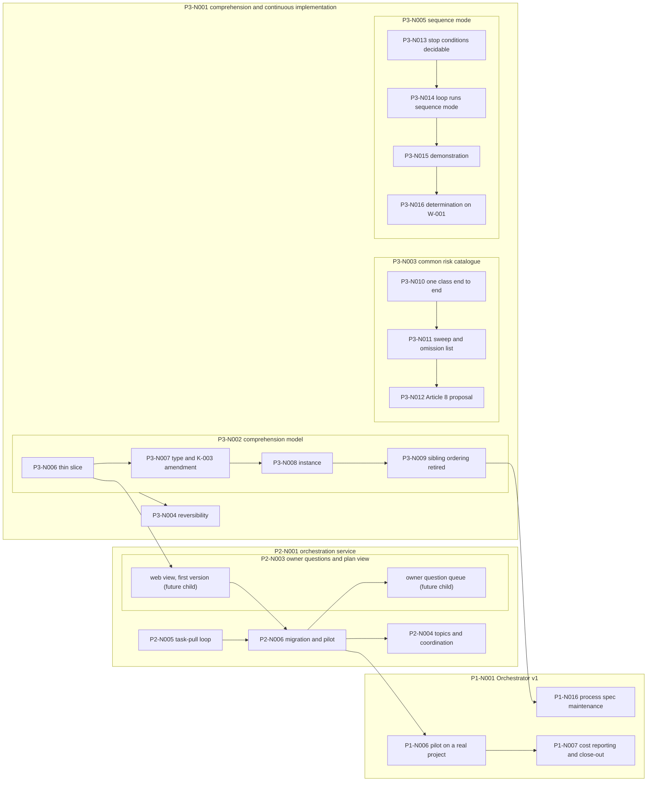

# The project plan, from the Plan register

Reader: the [human owner](https://github.com/majodali/methodology/blob/v1.6.0/docs/vocabulary.md#def-human-owner) returning after weeks away (RD-2 in the methodology's [reader catalog](https://github.com/majodali/methodology/blob/v1.6.0/docs/style.md#readers)), and a fresh agent session (RD-4).
Neither reader has the conversation history.
Both know the methodology at this project's pinned version, 1.6.0 ([Classification](classification.md)), and can follow links.

Status: active

<!-- K-007 contract: Status transitions draft → active → (superseded by
     X, because Y | closed → Backlog entry). Anything unmarked here is a
     live claim of current intent. This is the central plan document, a
     hand rendering of the Plan register. It goes `superseded` when the
     renderings of nodes P3-N006 and P3-N008 replace it. -->

This [document](https://github.com/majodali/methodology/blob/v1.6.0/docs/vocabulary.md#def-document) renders the [Plan register](plan-register.md) by hand.
Each node's outcome comes from the node's [plan](https://github.com/majodali/methodology/blob/v1.6.0/docs/vocabulary.md#def-plan) and [specification](https://github.com/majodali/methodology/blob/v1.6.0/docs/vocabulary.md#def-specification).
The rendering reads the register as it stands after the owner's plan gates of 2026-10-30.
Where this document and the register disagree, the register wins.

Today the Plan register holds the node tree and the stages.
Today the [Backlog](backlog.md) holds the implementation map (its [Completed](backlog.md#completed) section) and the list of what is next (its [Upcoming](backlog.md#upcoming) section).
K-003 (the Backlog is the single source of progress truth) requires that at 1.6.0.
On 2026-10-29 the owner decided that the [planning/execution model](https://github.com/majodali/methodology/blob/main/docs/vocabulary.md#def-planning-execution-model) takes over the implementation map and the list of what is next.
The decision is RU-021 (the planning/execution model is the source of progress truth), in the [Ruling register](rulings.md).
The takeover waits until the methodology releases the amendment to K-003 (the Backlog is the single source of progress truth) that P3-N007 drafts.
The owner carries that amendment upstream, under RU-002 (the owner hand-carries upstream output).
Before that [release](https://github.com/majodali/methodology/blob/v1.6.0/docs/vocabulary.md#def-release), this document is a rendering of the register with no authority of its own.

The [Orchestrator](process/roles.md#orchestrator) role updates this document in the commit that changes the register.
The duty follows the methodology's [W-003 (documentation moves in the same commit as the work)](https://github.com/majodali/methodology/blob/v1.6.0/docs/rules/working-agreement.md#w-003--documentation-moves-in-the-same-commit-as-the-work).
The duty ends when the renderings of P3-N006 (the thin end-to-end slice) and P3-N008 (the instance) replace this document.

## What the project builds: three lines of work

The repository majodali/project-orchestrator builds orchestration for the majodali portfolio in three lines of work.
Each line is a top-level [node](process/README.md#def-node) of the [Plan register](plan-register.md).

- P1-N001 (Orchestrator v1) delivers a process [specification](https://github.com/majodali/methodology/blob/v1.6.0/docs/vocabulary.md#def-specification) and a Claude Code plugin. The plugin runs role-based agent sessions through the methodology at low cost.
- P2-N001 (Orchestration service) delivers a service that agent sessions call over MCP (the Model Context Protocol, the tool interface Claude sessions use). The service shares plan state, coordination and owner questions between sessions. Git stays the place where the state is stored.
- P3-N001 (Project comprehension and continuous implementation) delivers a model that says what each part of a project is and what depends on it. The line adds three safeguards for longer runs of work without owner review.

The methodology's [vision](https://github.com/majodali/methodology/blob/main/docs/vision.md) states the portfolio direction the three lines serve.
The methodology's draft [roadmap](https://github.com/majodali/methodology/blob/main/docs/roadmap.ir.md) orders the next steps against these nodes.
The roadmap is written as an IR ([intermediate representation](https://github.com/majodali/methodology/blob/v1.6.0/docs/vocabulary.md#def-intermediate-representation), the methodology's claim-by-claim form of a text).

## How to read this document: stages, chunks, dependencies and gates

Every node of the [plan](https://github.com/majodali/methodology/blob/v1.6.0/docs/vocabulary.md#def-plan) carries one [stage](process/plan-model.md#the-node-lifecycle) from the node lifecycle.

- identified: the node exists in the [Plan register](plan-register.md), created by its parent's breakdown or at [enrollment](process/README.md#defined-terms) of the project.
- planned: the node's [plan](https://github.com/majodali/methodology/blob/v1.6.0/docs/vocabulary.md#def-plan) records its outcome, approach and dependencies.
- specified: the node's [specification](https://github.com/majodali/methodology/blob/v1.6.0/docs/vocabulary.md#def-specification) records its behavior and verification criteria.
- broken-down: a parent node's children are defined and entered in the register.
- executing: a leaf node's work is being done.
- verifying: the node is being checked against its own criteria.
- done: the node is verified and accepted. Its [Backlog](backlog.md) [entry](https://github.com/majodali/methodology/blob/v1.6.0/docs/vocabulary.md#def-entry) is rewritten to say what shipped.

A chunk, marked "(chunk 1)" in a node's name, is one step of a line that the owner reviews at its own [chunk gate](https://github.com/majodali/methodology/blob/v1.6.0/docs/vocabulary.md#def-chunk-gate).

Each node below carries five fields, always in this order.

- Stage: the current stage, with the date it was reached where a record states one.
- Outcome: for a done node, what shipped. For an open node, what done looks like.
- Depends on: the nodes, outside this node's own subtree, whose completion this node's work waits on. A parent's own children are never listed here, because a parent finishes when its children do.
- Needed by: the nodes that wait on this one.
- Documents: links to the node's plan and specification, where they exist.

The dependencies come from the register's notes and from the child order in each parent's specification.
RU-018 (a child is not queued behind a sibling it does not depend on) lets a node marked independent run beside its siblings.
For a node not marked independent, the default in [dispatch.md](process/dispatch.md) still applies today.
Under that default, a node starts executing only after the siblings listed before it in the register are done.
A register note that orders two siblings, such as the owner's notes of 2026-10-29 on P2-N004 and P2-N005, overrides the default for those siblings.
P3-N009 (sibling ordering retired) removes the default.
A gated node carries a `[gated: ...]` [hold marker](process/plan-register.md#location-and-shape).
The gated node moves only when the [human owner](https://github.com/majodali/methodology/blob/v1.6.0/docs/vocabulary.md#def-human-owner) rules at the node's gate.
A parent node finishes only after all its children are done.

Three terms of the comprehension model recur under P3-N002.
A facet is one labelled line of a part's [entry](https://github.com/majodali/methodology/blob/v1.6.0/docs/vocabulary.md#def-entry) in the model, such as `state` or `risks`.
An edge is a line saying that a node creates, modifies or uses a part.
The sketch notation is the draft entry format in the [P3-N002 plan](plans/p3-n002-comprehension-model.md#where-the-entries-live-and-what-one-looks-like).

## P1-N001 Orchestrator v1, the process specification and the plugin

- Stage: broken-down since enrollment.
- Outcome: A process [specification](https://github.com/majodali/methodology/blob/v1.6.0/docs/vocabulary.md#def-specification) and a Claude Code plugin that runs it at low cost, tried on one real portfolio project.
- Depends on: nothing beyond its children.
- Needed by: nothing.
- Documents: the [founding plan](plans/orchestrator-v1.md).

### P1-N002 Bootstrap and founding plan (chunk 1)

- Stage: done before the [Plan register](plan-register.md) existed. No record states the date.
- Outcome: Shipped the repository's methodology files and the founding [plan](https://github.com/majodali/methodology/blob/v1.6.0/docs/vocabulary.md#def-plan).
- Depends on: nothing.
- Needed by: P1-N003.
- Documents: [plan, chunk 1](plans/orchestrator-v1.md#chunk-1--bootstrap-and-founding-plan).

### P1-N003 Process specification v1 (chunk 2)

- Stage: done, 2026-08-24, when the owner approved the review revisions.
- Outcome: Shipped [docs/process/](process/), holding the node lifecycle, the register formats, the dispatch loop and the [Cost log](cost-log.md) format.
- Depends on: P1-N002.
- Needed by: P1-N004.
- Documents: [plan, chunk 2](plans/orchestrator-v1.md#chunk-2--process-specification-v1).

### P1-N004 Role definitions v1 (chunk 3)

- Stage: done before the register existed. No record states the date.
- Outcome: Shipped the role contracts in [roles.md](process/roles.md), including the Auditor's duty to run `mtool`, the audit tool of [methodology-tools](https://github.com/majodali/methodology-tools).
- Depends on: P1-N003.
- Needed by: P1-N005.
- Documents: [plan, chunk 3](plans/orchestrator-v1.md#chunk-3--role-definitions-v1).

### P1-N005 Plugin v1 with self-hosted trial (chunk 4)

- Stage: done, 2026-08-26, at the owner's demonstration gate.
- Outcome: Shipped the `orchestrator` plugin: role agents, process skills, a [form checker](process/auditing.md#form-checks--a-tool-never-an-agent), a [run journal](process/observability.md) viewer and a billing check.
- Depends on: P1-N004.
- Needed by: P1-N006, whose pilot now runs inside P2-N006.
- Documents: [plan, chunk 4](plans/orchestrator-v1.md#chunk-4--plugin-v1).

### P1-N008 mtool checker extension-point proposal

- Stage: done, 2026-08-26.
- Outcome: Shipped a proposal to methodology-tools: a format a project defines for its own files may name its own checker, which `mtool audit form` then runs.
- Depends on: nothing.
- Needed by: nothing open.
- Documents: [plan](plans/p1-n008-mtool-checker-extension-point.md), [specification](specs/p1-n008-mtool-checker-extension-point.md).

### P1-N009 Plugin tooling on the portfolio stack

- Stage: done, 2026-08-31.
- Outcome: Shipped the plugin's three scripts in TypeScript on Node. One Plan register parser is shared with the service.
- Depends on: nothing.
- Needed by: nothing open.
- Documents: [plan](plans/p1-n009-plugin-tooling-portfolio-stack.md), [specification](specs/p1-n009-plugin-tooling-portfolio-stack.md).

The children of P1-N009, in their chain order:

- P1-N010 Node toolchain and the shared register grammar, proven by journal_tail
  - Stage: done, 2026-08-30.
  - Outcome: Shipped the Node toolchain and the shared register parser. Their first user was `journal_tail`, the plugin's script that prints the latest run journal events.
  - Depends on: nothing.
  - Needed by: P1-N011.
  - Documents: the parent's plan and specification.
- P1-N011 The travelling package: conformance corpus, recorded expectations, vendoring generator
  - Stage: done, 2026-08-30.
  - Outcome: Shipped test fixtures, their expected results, and a script that copies the shared parser into other repositories.
  - Depends on: P1-N010.
  - Needed by: P1-N012.
  - Documents: the parent's plan and specification.
- P1-N012 The form checker on the shared unit, proven finding-for-finding
  - Stage: done, 2026-08-30.
  - Outcome: Shipped the form checker in TypeScript, reporting exactly the findings the Python version reported.
  - Depends on: P1-N011.
  - Needed by: P1-N013.
  - Documents: the parent's plan and specification.
- P1-N013 The cutover: sync_agents ported, every invocation site moved, the Python retired
  - Stage: done, 2026-08-30.
  - Outcome: Shipped `sync_agents`, the script that copies the role contracts into the plugin, in TypeScript. That commit also removed the Python scripts.
  - Depends on: P1-N012.
  - Needed by: nothing.
  - Documents: the parent's plan and specification.

### P1-N014 Role contracts adopt the methodology's conduct rules

- Stage: done, 2026-10-29.
- Outcome: Shipped seventeen conduct duties, stated once in `docs/process/` and carried by the six role contracts.
- Depends on: nothing.
- Needed by: P3-N014 (the loop runs sequence mode) and P2-N006 (migration and pilot). Both waits are met, because this node is done.
- Documents: [plan](plans/p1-n014-role-contracts-adopt-v140-rules.md), [specification](specs/p1-n014-role-contracts-adopt-conduct-rules.md).

### P1-N015 Methodology amendments for delegated, multi-agent work

- Stage: done, 2026-09-01.
- Outcome: Shipped four amendment proposals, which the methodology accepted and released in v1.5.0.
- Depends on: nothing.
- Needed by: nothing open.
- Documents: [plan](plans/p1-n015-methodology-amendments-delegated-work.md), [specification](specs/p1-n015-methodology-amendments-delegated-work.md).

### P1-N016 Process spec maintenance: branch lifecycle, PR citation, packet table

- Stage: planned, 2026-10-30 (task T074). Gated on the owner's review of the plan: seventeen decisions and five names.
- Outcome: Every Backlog row routed to this node, thirty-five in all, is landed in the process specification or closed with a stated reason. `dispatch.md` says who deletes a task branch and when, and how work reaches `main` by pull request. The packet table carries every observation recorded against it. `plan-model.md` says what a leaf is when its work takes several tasks. `observability.md` can record a block's release and a new risk. The project gains a vocabulary file. Each process-scope ruling flagged for promotion is promoted or declined.
- Depends on: P3-N007's first execute task, which is done. The recorded wait of its executing stage on P3-N009 (sibling ordering retired) stands until the gate; the plan's decision 3 proposes to remove it, because the node edits no text P3-N009 owns.
- Needed by: P1-N001.
- Documents: [plan](plans/p1-n016-process-spec-maintenance.md).

### P1-N006 Pilot on a real project (chunk 5)

- Stage: identified at enrollment. No plan yet.
- Outcome: The pilot this node was created for now runs inside P2-N006 (migration and pilot), through the service. No work remains in P1-N006 itself. The node is not done. It stays identified until P2-N006 is done. P1-N007 then retires it with the founding plan. P1-N006 has no executing stage of its own, so the sibling-order default does not reach it.
- Depends on: P2-N006.
- Needed by: P1-N007.
- Documents: [plan, chunk 5](plans/orchestrator-v1.md#chunk-5--pilot-on-a-real-project).

### P1-N007 Cost reporting v1 and close-out (chunk 6)

- Stage: identified at enrollment. No plan yet.
- Outcome: Reports of cost per node, role and tier, drawn from the Cost log, the run journal and the service. A review against the founding plan's two goals, then the founding plan closed.
- Depends on: P1-N006, by the dispatch.md default, for its executing stage. Its planning can start at any time.
- Needed by: P1-N001.
- Documents: [plan, chunk 6](plans/orchestrator-v1.md#chunk-6--cost-reporting-v1-and-close-out).

## P2-N001 Orchestration service

- Stage: broken-down, 2026-08-26.
- Outcome: A service that agent sessions call over MCP, holding shared [plan](https://github.com/majodali/methodology/blob/v1.6.0/docs/vocabulary.md#def-plan) state, coordination and owner questions, with git as the store.
- Depends on: nothing beyond its children.
- Needed by: nothing.
- Documents: [plan](plans/orchestration-service.md).

### P2-N002 Service skeleton and plan state (chunk 1)

- Stage: done, 2026-09-16.
- Outcome: Shipped a deployed MCP service that reads and updates the project's plan state, while sessions keep working through git when the service is down.
- Depends on: nothing.
- Needed by: P2-N005 (the task-pull loop).
- Documents: [plan](plans/p2-n002-service-skeleton.md), [specification](specs/p2-n002-service-skeleton.md).

The children of P2-N002, in their [specification](specs/p2-n002-service-skeleton.md#the-breakdown)'s order:

- P2-N007 Service repository bootstrap
  - Stage: done, 2026-08-27.
  - Outcome: Shipped the service repository with a TypeScript skeleton that builds, tests and lints clean.
  - Depends on: nothing.
  - Needed by: P2-N008 and P2-N009.
  - Documents: the parent's plan and specification.
- P2-N008 Reachability slice: a deployed MCP server a session can call
  - Stage: done, 2026-08-28.
  - Outcome: Shipped a deployed MCP server with one identity tool and token authentication, reached from local and web sessions.
  - Depends on: P2-N007.
  - Needed by: P2-N011.
  - Documents: the parent's plan and specification.
- P2-N009 Plan-state read
  - Stage: done, 2026-08-30.
  - Outcome: Shipped `plan_read`, which parses the [Plan register](plan-register.md) and names the source commit in every answer.
  - Depends on: P2-N007.
  - Needed by: P2-N010.
  - Documents: the parent's plan and specification.
- P2-N010 Plan-state update, git-authoritative, with the advisory lease
  - Stage: done, 2026-09-01.
  - Outcome: Shipped register updates through the service while one session holds a short-lived write lock.
  - Depends on: P2-N009.
  - Needed by: P2-N011.
  - Documents: the parent's plan and specification.
- P2-N011 Degrade to git-only, and enlistment documentation
  - Stage: done, 2026-09-07.
  - Outcome: Shipped proof that sessions keep working through git when the service is down. Shipped the [guide](process/enlistment.md) to connecting a repository through `.mcp.json`.
  - Depends on: P2-N008 and P2-N010.
  - Needed by: nothing.
  - Documents: the parent's plan and specification.

### P2-N012 Deploy the service from CI on merge

- Stage: done, 2026-09-07.
- Outcome: Shipped automatic deployment: checks on every pull request, and a deploy on merge that goes live only after a smoke test passes.
- Depends on: nothing. The owner ruled at its gate that P2-N011 was not a dependency.
- Needed by: nothing open.
- Documents: [plan](plans/p2-n012-deploy-from-ci-on-merge.md), [specification](specs/p2-n012-deploy-from-ci-on-merge.md).

The children of P2-N012, in their [specification](specs/p2-n012-deploy-from-ci-on-merge.md#the-breakdown)'s order:

- P2-N013 Alias assumptions verified against AWS documentation
  - Stage: done, 2026-09-01.
  - Outcome: Shipped a written check of six deployment assumptions against dated AWS documentation.
  - Depends on: nothing.
  - Needed by: P2-N015.
  - Documents: the parent's plan and specification.
- P2-N014 Pull-request checks that cannot deploy
  - Stage: done, 2026-09-01.
  - Outcome: Shipped pull-request checks for build, lint, tests and template validation, with no access to deploy credentials.
  - Depends on: nothing.
  - Needed by: nothing.
  - Documents: the parent's plan and specification.
- P2-N015 Alias-aware lease-table selection, failing closed
  - Stage: done, 2026-09-01.
  - Outcome: Shipped a separate write-lock table for the test deployment, with any unknown deployment refused.
  - Depends on: P2-N013.
  - Needed by: P2-N016.
  - Documents: the parent's plan and specification.
- P2-N016 Deploy, smoke and promote on merge to main
  - Stage: done, 2026-09-07.
  - Outcome: Shipped the merge job that deploys, smoke-tests and promotes, with rollback steps in the service's [runbook](https://github.com/majodali/methodology/blob/v1.6.0/docs/vocabulary.md#def-runbook).
  - Depends on: P2-N015.
  - Needed by: nothing.
  - Documents: the parent's plan and specification.

### P2-N003 Owner questions and the plan view (chunk 2)

- Stage: planned, 2026-10-30 (task T075); plan gate crossed 2026-10-30 with defaults 1 to 10. The specification (task T093) is being written; it carries the web view child at full criteria depth and the queue child at outcome depth, and both enter the register at its gate.
- Outcome: The service plan gives this chunk an owner question queue and a first view of the plan. P2-N003 stays one node until its planning splits it into two children. One child is the first version of the [web view](https://github.com/majodali/methodology/blob/main/docs/vocabulary.md#def-web-view), read-only and drilling down to node and task. The second child is the owner question queue.
- Depends on: nothing for its own planning, which performs the split. After the split, the web view child waits on P3-N006 (the thin end-to-end slice). The queue child waits on P2-N006 (migration and pilot).
- Needed by: P2-N006, which needs the web view child only.
- Documents: [plan](plans/p2-n003-owner-questions-and-plan-view.md), [service plan, chunk 2](plans/orchestration-service.md#chunk-2--owner-questions-and-the-plan-view).

### P2-N004 Topics and coordination (chunk 3)

- Stage: identified, 2026-08-26. No plan yet.
- Outcome: Topics, which are shared threads where sessions post status and coordinate, including who is blocked on what. The owner starts P2-N004 only if the pilot shows that sessions need topics.
- Depends on: P2-N006 (migration and pilot), for its executing stage. Its planning starts when the owner sees the need.
- Needed by: nothing.
- Documents: [service plan, chunk 3](plans/orchestration-service.md#chunk-3--topics-and-coordination).

### P2-N005 The task-pull loop (chunk 4)

- Stage: planned, 2026-10-30 (task T073); plan gate crossed 2026-10-30 with defaults 1 to 13 and four terms ratified. The specification (task T092) is being written; it carries the four children at breakdown depth, and they are entered at its gate.
- Outcome: A session asks the service for its next task and claims the task, so no other session takes it. The session then reports progress and completion. When the service is down, a session claims a task by creating a git branch named after the task.
- Depends on: P2-N002 (service skeleton and plan state), which is done. The register marks P2-N005 independent of P2-N003 and P2-N004.
- Needed by: P2-N006.
- Documents: [plan](plans/p2-n005-task-pull-loop.md), [service plan, chunk 4](plans/orchestration-service.md#chunk-4--the-task-pull-loop).

### P2-N006 Migration and pilot (chunk 5)

- Stage: identified, 2026-08-26. No plan yet.
- Outcome: The orchestration of majodali/project-orchestrator moves onto the service. Then the pilot runs on methodology-tools through the service. The owner chose methodology-tools on 2026-10-29. The pilot records its costs and lessons.
- Depends on: P2-N005, the web view child of P2-N003, and P1-N014, which is done.
- Needed by: P1-N006, P2-N004, and the queue child of P2-N003.
- Documents: [service plan, chunk 5](plans/orchestration-service.md#chunk-5--migration-and-pilot).

## P3-N001 Project comprehension and continuous implementation

- Stage: broken-down, 2026-09-17.
- Outcome: One model of a project's parts, defined in majodali/project-orchestrator and usable by every orchestrated project. The line's aim is that dependencies are written down, never guessed from list order. Three safeguards make longer unreviewed runs safe: a shared risk catalogue, cheap undoing of work, and a decision on [sequence mode](#p3-n005-sequence-mode-chunk-4), described under P3-N005.
- Depends on: nothing beyond its children.
- Needed by: nothing.
- Documents: [plan](plans/comprehension-and-continuous-implementation.md), [specification](specs/p3-n001-comprehension-and-continuous-implementation.md).

### P3-N002 The comprehension model (chunk 1)

- Stage: broken-down, 2026-10-29.
- Outcome: A new [custom document type](https://github.com/majodali/methodology/blob/v1.6.0/docs/vocabulary.md#def-custom-document-type), the Project model, and one instance of it over majodali/project-orchestrator. For any part a reader names, the instance says what the part is, its state, its [specification](https://github.com/majodali/methodology/blob/v1.6.0/docs/vocabulary.md#def-specification), its risks and its dependencies. A reader reaches each answer in at most three steps, using git and a text editor. The model has two renderings, the implementation map and the list of what is next, produced from the model alone. The two renderings reproduce the Backlog's two lists.
- Depends on: nothing beyond its children.
- Needed by: P3-N004.
- Documents: [plan](plans/p3-n002-comprehension-model.md), [specification](specs/p3-n002-comprehension-model.md).

The children of P3-N002, a strict chain in their [specification](specs/p3-n002-comprehension-model.md#the-breakdown)'s order:

- P3-N006 The thin end-to-end slice: five real parts all the way through, and both renderings
  - Stage: done, 2026-10-30 (task T054).
  - Outcome: Shipped `docs/project-model.md`, five real parts through every facet, and the slice record with fifty measured paths, both renderings compared with the Backlog, and fourteen findings for P3-N007.
  - Depends on: nothing.
  - Needed by: P3-N007, and the [web view](https://github.com/majodali/methodology/blob/main/docs/vocabulary.md#def-web-view) child of P2-N003.
  - Documents: [plan](plans/p3-n006-thin-end-to-end-slice.md), [specification](specs/p3-n002-comprehension-model.md#child-a-the-thin-end-to-end-slice-five-real-parts-all-the-way-through).
- P3-N007 The type declared, the arguments written, the K-003 (the Backlog is the single source of progress truth) amendment drafted
  - Stage: executing since 2026-10-30. The parent specification's child B section is the specification (gate decision of the same day). E1 is done (task T070, the type specification). The fifty edges E1 held were transcribed into the Project model instance by task T077. E2 is done (task T078): the K-003 proposal and its IR, `docs/proposals/planning-execution-model-is-progress-truth.md`. Its ten stranger rounds (tasks T081 to T091) ran to the limit without a readable verdict; the final round's fixes are confirmed and the record carries Meta-review: pending. The node is verifying, gated on your review of the proposal under RU-005, ten terms, and a meta-review of the count.
  - Outcome: The Project model is defined in `docs/process/` and declared in the [Classification](classification.md). The design arguments are written down, such as who may write the model and where a node's edges are first recorded. P3-N007 drafts the amendment to K-003 (the Backlog is the single source of progress truth), as an IR first. Under the amendment, a project that declares a [planning/execution model](https://github.com/majodali/methodology/blob/main/docs/vocabulary.md#def-planning-execution-model) takes that model as its progress record. The rule changes only when the methodology releases the amendment, after the owner carries it upstream.
  - Depends on: P3-N006.
  - Needed by: P3-N008.
  - Documents: [plan](plans/p3-n007-type-declared-amendment-drafted.md), the parent's specification, child B.
- P3-N008 The instance, over this repository
  - Stage: planned, 2026-10-30 (task T079). Gated on the owner's review of the plan, six decisions.
  - Outcome: The instance `docs/project-model.md` holds one entry per current part of majodali/project-orchestrator, in the type's grammar, every item naming its source. Every node past identified has an edge or the preamble says why not. Every starting point links the instance in its header. A population record holds the enumeration, the edge list, the measured paths, both renderings and their comparison with the Backlog, run in both directions. The Backlog stays the referent for what is done and what is next. The plan runs the node as three execute tasks: the parts and their entries, the edges, then the headers, the measurement and the renderings. Under its decision 5 this document stays the hand rendering until the Backlog switches to a rendering of the model.
  - Depends on: P3-N007, for its executing stage (P3-N007 decision 9). Its plan was dispatched after P3-N007's first execute task was accepted.
  - Needed by: P3-N009.
  - Documents: [plan](plans/p3-n008-instance-over-this-repository.md), the parent's [specification, child C](specs/p3-n002-comprehension-model.md#child-c-the-instance-over-this-repository).
- P3-N009 Sibling ordering retired, and the checks that replace it
  - Stage: identified, 2026-10-29. No plan yet.
  - Outcome: Four statements that make list order mean dependency order are rewritten, in `plan-register.md`, `plan-model.md`, `dispatch.md` and the [Plan register](plan-register.md)'s header. Afterwards [dispatch.md](process/dispatch.md) starts a node only when the nodes that create the parts it uses, and the modifying nodes its edges name, are done. The form checker gains checks on the Project model, for example that every edge names a known part.
  - Depends on: P3-N008.
  - Needed by: P1-N016, whose executing stage builds on the new dispatch rule.
  - Documents: the parent's [specification, child D](specs/p3-n002-comprehension-model.md#child-d-sibling-ordering-retired-and-the-checks-that-replace-it).

### P3-N003 The common risk catalogue (chunk 2)

- Stage: broken-down, 2026-10-29.
- Outcome: A catalogue of risk classes every orchestrated project must guard against, drafted and reviewed in majodali/project-orchestrator. Each [entry](https://github.com/majodali/methodology/blob/v1.6.0/docs/vocabulary.md#def-entry) names the real incident it came from, with a date. A check applies the catalogue to majodali/project-orchestrator and lists the parts that no risk entry covers. The owner carries the catalogue upstream, under RU-002. The node carries nothing upstream.
- Depends on: nothing beyond its children. The [Plan register](plan-register.md) marks P3-N003 independent of P3-N002.
- Needed by: nothing.
- Documents: [plan](plans/p3-n003-common-risk-catalogue.md), [specification](specs/p3-n003-common-risk-catalogue.md).

The children of P3-N003, a strict chain in their [specification](specs/p3-n003-common-risk-catalogue.md#the-breakdown)'s order:

- P3-N010 One class, carried end to end
  - Stage: done, 2026-10-30 (task T055).
  - Outcome: Shipped the catalogue's first class, CR-001 (a check that cannot fail in the environment the code runs in), with five independent encounters; the check document with the thirty-part enumeration, the run record, an eight-item omission list and the negative control that caught a removed citation.
  - Depends on: nothing.
  - Needed by: P3-N011.
  - Documents: [plan](plans/p3-n010-one-class-end-to-end.md), [specification](specs/p3-n003-common-risk-catalogue.md#child-a-one-class-carried-end-to-end).
- P3-N011 The sweep, the rest of the catalogue, and the omission list
  - Stage: executing since 2026-10-30. The parent specification's child B section is the specification (gate decision of the same day). All three tasks are done (T071, T080, T083): the five passes recorded, 128 candidates found, classes CR-002 to CR-012 admitted, six deferred; nine Class lines on the Risk register; 35 parts; the check run over 12 classes and 35 parts, 82 applicable pairs, 26 covered, 56 omissions (11 accepted with a reason, 45 routed to 18 Backlog entries); the negative control on CR-003 returned its pair. The node is verifying, gated on your rulings on the omission list, three weaker Class lines (R5, R9, R10), the scope arguments and closed entries; it reaches done at that gate.
  - Outcome: The sweep reads five sources, named by the parent specification's [criterion B1](specs/p3-n003-common-risk-catalogue.md#verification-criteria): the Risk register, the Backlog's two sections, the Cost log's notes and the Ruling register. Every candidate class is admitted, merged, rejected or deferred, on the record. Risk entries cite their classes. The list of uncovered parts is ready for the owner.
  - Depends on: P3-N010.
  - Needed by: P3-N012.
  - Documents: [plan](plans/p3-n011-sweep-and-omission-list.md), the parent's specification, child B.
- P3-N012 The Article 8 proposal, written IR first and reviewed
  - Stage: identified, 2026-10-29. No plan yet.
  - Outcome: The catalogue and a cover note become an amendment proposal under the methodology's Article 8 (amendments, versions, and migration). Both are written as IRs first and judged readable by a [stranger](https://github.com/majodali/methodology/blob/v1.6.0/docs/vocabulary.md#def-stranger) reviewer. The owner carries the proposal upstream, under RU-002. The node carries nothing upstream.
  - Depends on: P3-N011.
  - Needed by: nothing.
  - Documents: the parent's [specification, child C](specs/p3-n003-common-risk-catalogue.md#child-c-the-article-8-proposal-written-ir-first-and-reviewed).

### P3-N004 Reversibility, and the measurement that says whether it pays (chunk 3)

- Stage: identified, 2026-09-17. No plan yet.
- Outcome: Work in progress becomes cheap to undo and redo. A measurement over the project's cost history shows whether cheap undoing saves more than it costs. The Cost log gains a field naming which earlier task a redo repeats. An unfavourable result still counts as done, under RU-019 (a measurement criterion may be met by an unfavourable result).
- Depends on: P3-N002.
- Needed by: nothing.
- Documents: none yet. The parent's [specification](specs/p3-n001-comprehension-and-continuous-implementation.md#the-breakdown), chunk 3, holds the detail.

### P3-N005 Sequence mode (chunk 4)

- Stage: broken-down, 2026-10-29.
- Outcome: The dispatch loop gains the sequence mode of the methodology's W-001 (two delivery modes, human-gated). In that mode the owner approves a run of several chunks at once, so no gate falls between them. Asks are the decisions a report requests of its reader. The run stops on a failed check, a scope change, a chunk needing the owner, or a result carrying asks. Each stop condition becomes a rule that reads one named field and returns stop or continue. A recorded decision says whether W-001 (two delivery modes, human-gated) needs a methodology change.
- Depends on: nothing beyond its children. The register marks P3-N005 independent of P3-N002.
- Needed by: nothing.
- Documents: [plan](plans/p3-n005-sequence-mode.md), [specification](specs/p3-n005-sequence-mode.md).

The children of P3-N005, a strict chain in their [specification](specs/p3-n005-sequence-mode.md#the-breakdown)'s order:

- P3-N013 The four stop conditions, decidable, evidenced, and related to the [meta-review signals](https://github.com/majodali/methodology/blob/v1.6.0/docs/vocabulary.md#def-meta-review-signal)
  - Stage: done, 2026-10-30 (tasks T056 and T059 to T067).
  - Outcome: Shipped the four stop conditions as written predicates that two blind readers applied identically to all 53 past task results (212 of 212 rows, after two text revisions), the corpus statement, the relation table to the meta-review signals, and sixteen Backlog rows naming what the loop must record for the predicates to decide at landing.
  - Depends on: nothing.
  - Needed by: P3-N014.
  - Documents: [plan](plans/p3-n013-stop-conditions-decidable.md), [specification](specs/p3-n005-sequence-mode.md#child-a-the-four-stop-conditions-decidable-evidenced-and-related-to-the-meta-review-signals).
- P3-N014 The loop runs sequence mode, and the roles meet the conditions without looking
  - Stage: done, 2026-10-30 (task T072).
  - Outcome: Shipped the *Sequence mode* section of dispatch.md with the four stop predicates copied from P3-N013's record, the member's result record, the addressee rule in every result shape, the conditions each role can trigger in its contract, and the two journal event kinds, with thirteen routed Backlog rows landed.
  - Depends on: P3-N013, and the executing stage of P1-N014, which is done.
  - Needed by: P3-N015.
  - Documents: [plan](plans/p3-n014-loop-runs-sequence-mode.md), the parent's specification, child B.
- P3-N015 The demonstration: a ratified sequence lands two chunks and stops on asks
  - Stage: planned, 2026-10-30 (task T076). Gated on the owner's review of the plan, seven decisions, and on the owner's explicit ratification of the sequence in words that say so.
  - Outcome: The owner ratifies one sequence of four members, each an open Backlog item of this repository: the process specification's methodology links retargeted to the pin, anchors on the Risk register entries, the cover note for the checker extension-point proposal, and a test that runs the plugin tools as child processes. The first two land with no gate between them. The third carries an ask of the owner and stops the sequence. The fourth is ratified and never dispatched by the sequence. Two blind readings apply the four stop predicates to the run's results.
  - Depends on: P3-N014, which is done.
  - Needed by: P3-N016.
  - Documents: [plan](plans/p3-n015-sequence-demonstration.md), the parent's [specification, child C](specs/p3-n005-sequence-mode.md#child-c-the-demonstration-a-ratified-sequence-lands-two-chunks-and-stops-on-asks).
- P3-N016 The determination on W-001 (two delivery modes, human-gated), and the artifact or the argument
  - Stage: identified, 2026-10-29. No plan yet.
  - Outcome: The decision is recorded, as an amendment proposal or as an argument that the sequence mode needs no change.
  - Depends on: P3-N015.
  - Needed by: nothing.
  - Documents: the parent's [specification, child D](specs/p3-n005-sequence-mode.md#child-d-the-determination-on-w-001-and-the-artifact-or-the-argument).

## How the lines depend on each other

Four waits cross between the lines of the [plan](https://github.com/majodali/methodology/blob/v1.6.0/docs/vocabulary.md#def-plan). The first two are met, the last two are open.

- P3-N014 (the loop runs sequence mode) waits on the executing stage of P1-N014 (role contracts adopt the conduct rules), which is done.
- P2-N006 (migration and pilot) waits on P1-N014, which is done.
- The [web view](https://github.com/majodali/methodology/blob/main/docs/vocabulary.md#def-web-view)'s first version, a future child of P2-N003 (owner questions and the plan view), waits on P3-N006 (the thin end-to-end slice).
- The executing stage of P1-N016 (process spec maintenance) waits on P3-N009 (sibling ordering retired).

One piece of work moved between lines: P2-N006 took over the pilot of P1-N006 (pilot on a real project), and P1-N006 stays in line P1 as a node with no work of its own.

Inside each line the open nodes form chains, listed here from first to last.

- Line P2: P2-N005 (the task-pull loop) and the web view child of P2-N003 come before P2-N006. P2-N004 (topics and coordination) and the queue child of P2-N003 come after P2-N006.
- Line P1: P1-N006 comes before P1-N007 (cost reporting and close-out).
- Line P3, the comprehension model: P3-N006, then P3-N007, then P3-N008, then P3-N009. P3-N004 (reversibility) waits on the whole of P3-N002.
- Line P3, the risk catalogue: P3-N010, then P3-N011, then P3-N012.
- Line P3, sequence mode: P3-N013, then P3-N014, then P3-N015, then P3-N016.

The diagram shows every node that is not done.
An arrow runs from a node to the node that waits on it.
A box around nodes is their parent.
P2-N003's two future children are drawn as separate nodes inside its box, because each has its own wait.

## What is next: actionable, gated, waiting, and unplanned nodes

A node is actionable when every recorded dependency of its next stage is met.

Actionable, not yet dispatched:

- P1-N007 (cost reporting and close-out): planning. Its executing stage waits on P1-N006.

Specifying now, after the owner's gate of 2026-10-30:

- P2-N005 (the task-pull loop): the specification, task T092; children A to D (the platform facts, the loop in git alone, role-aware identity, the task tools) enter at its gate.
- P2-N003 (owner questions and the plan view): the specification, task T093; the web view's first version and the owner question queue enter at its gate.

Executing now, dispatched after the owner's second plan gates of 2026-10-30:

Gated on the owner:

- P1-N016 (process spec maintenance): the owner's review of its plan, seventeen decisions and five names. Its executing stage's recorded wait on P3-N009 is decision 3 of that review.
- P3-N015 (the demonstration): the owner's review of its plan, seven decisions, and the explicit ratification of the sequence of four members.
- P3-N008 (the instance): the owner's review of its plan, six decisions.
- P3-N007 (the type declared, the arguments written, the K-003 amendment drafted): verifying; your review of the K-003 proposal under RU-005 (approve for carrying, amend or return), ten terms, the open points of its record, and a meta-review of its count.
- P3-N011 (the sweep, the rest of the catalogue, and the omission list): verifying; the owner's rulings on the omission list (56 items), the three weaker Class lines, the scope arguments and closed entries, and the terms citation test and delta row.
- P2-N004 (topics and coordination): the owner's call to start it, after P2-N006, on a shown need.

Waiting:

- P3-N008 (the instance): its executing stage waits on P3-N007. Its plan is gated, below.
- P3-N009 (sibling ordering retired): waits on P3-N008.
- P3-N012 (the Article 8 proposal): waits on P3-N011.
- P3-N016 (the determination): waits on P3-N015.
- P3-N004 (reversibility): waits on P3-N002.
- P2-N003 (owner questions and the plan view), after its split: the [web view](https://github.com/majodali/methodology/blob/main/docs/vocabulary.md#def-web-view) child waits on P3-N006. The queue child waits on P2-N006.
- P2-N006 (migration and pilot): waits on P2-N005 and the web view child of P2-N003.
- P2-N004 (topics and coordination): its executing stage waits on P2-N006.
- P1-N006 (pilot on a real project): waits on P2-N006.
- P1-N007 (cost reporting and close-out): its executing stage waits on P1-N006.
- P3-N002, P3-N003 and P3-N005: each waits on its children.
- P1-N001, P2-N001 and P3-N001: each waits on its open children.

No plan yet, in register order:

- P1-N006 (pilot on a real project)
- P1-N007 (cost reporting and close-out)
- P2-N004 (topics and coordination)
- P2-N006 (migration and pilot)
- P3-N009 (sibling ordering retired)
- P3-N004 (reversibility)
- P3-N012 (the risk catalogue's last child)
- P3-N016 (sequence mode's last child)

## Where the detail is: the documents this plan summarizes

- [Plan register](plan-register.md): the node tree and the stages.
- [Process specification](process/): the node lifecycle, dispatch, the roles and the register formats.
- [Plans](plans/) and [specifications](specs/): each node's outcome, approach, criteria and breakdown.
- [Backlog](backlog.md): what each done node shipped, and the open items that are not nodes.
- [Ruling register](rulings.md): the owner's recurring decisions.
- [Risk register](open-risks.md): the open and closed risks the nodes guard against.
- [Cost log](cost-log.md) and [run journal](process/observability.md): the cost of each task, and the record of each dispatch and result.
